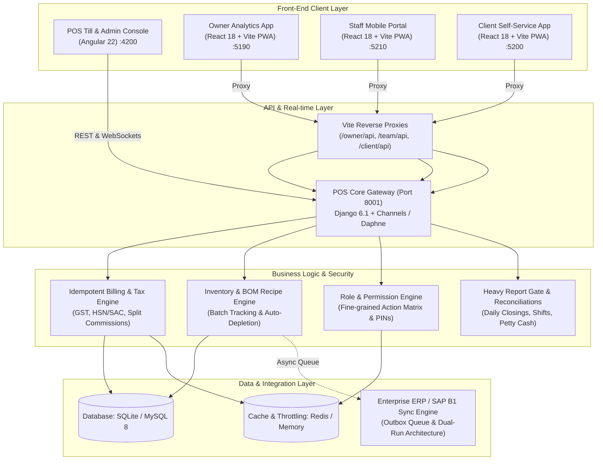

# Aura POS — Enterprise Multi-Location Salon POS & Management Ecosystem

A production-grade, omnichannel Point of Sale (POS) and operations suite built for high-volume, multi-branch luxury salon and spa chains.

The platform provides a centralized **Django REST & WebSocket backend**, an **Angular POS Till & Back-Office Web App**, and **three dedicated React (PWA) companion applications** designed specifically for Clients, Staff Members, and Business Owners.

---

## 🏛️ System Architecture



---

## 📱 The 4 Applications

### 1. POS Till & Admin Console (`pos/`)
* **Stack:** Angular 22, RxJS, Chart.js, Font Awesome.
* **Ports:** Web UI on `http://localhost:4200`, Backend API on `http://127.0.0.1:8001`.
* **Key Features:**
  - **High-Speed Checkout:** Keyboard-driven till, multi-mode split tenders (Cash, Card, UPI, Advance Wallet, Value Cards, Memberships).
  - **Appointment Calendar:** Interactive multi-stylist appointment grid with status tracking (Scheduled, Checked-in, In-service, Completed, No-show).
  - **Inventory & BOM Recipe Tracking:** Real-time stock ledgers with automatic batch tracking and backbar consumable deduction per service rendered.
  - **Multi-Branch Stock Transfers:** Multi-step approval workflow (Request -> Approve -> Dispatch -> Goods Receipt).
  - **Granular RBAC:** Ticks-based permissions across 10 distinct job roles with strict branch isolation.

### 2. Owner Analytics App (`owner-app/`)
* **Stack:** React 18, Vite, TypeScript, Lucide Icons, Modern Glassmorphism UI.
* **Port:** `http://localhost:5190`
* **Key Features:**
  - **Real-Time Performance:** Today's net sales, invoice volume, footfall, average ticket size, and month-to-date targets.
  - **Salon Comparison:** Cross-location benchmarking and ranking.
  - **Staff Leaderboard:** Top performers, revenue contribution, and service vs. product sales split.
  - **Master PIN Security:** Time-sensitive, encrypted daily master PIN generator for authorization overrides.

### 3. Staff Mobile Portal (`staff-app/`)
* **Stack:** React 18, Vite, TypeScript, Mobile-first Touch UX.
* **Port:** `http://localhost:5210`
* **Key Features:**
  - **Digital Job Card:** Itemized daily service credits, product commissions, and tip tracking.
  - **Personal Schedule:** Live feed of booked and upcoming client appointments.
  - **Monthly Earnings:** Performance breakdowns and incentive tier tracking.
  - **Quick PIN Access:** Frictionless 4-digit PIN authentication.

### 4. Client Self-Service Portal (`clients-app/`)
* **Stack:** React 18, Vite, TypeScript, PWA.
* **Port:** `http://localhost:5200`
* **Key Features:**
  - **Digital Wallet:** Prepaid balances, cashback rewards, gift vouchers, and active package redemptions.
  - **Appointment Booking:** Self-service stylist selection, service menu browsing, and appointment booking.
  - **Receipts Vault:** Transparent itemized tax invoices with complete visit history.
  - **Security PIN:** Secure 4-digit client PIN protecting prepaid wallet balances from unauthorized till usage.

---

## ⚡ Core Enterprise Highlights

1. **Idempotent Billing & Double-Submit Protection**:
   Every bill generation generates and verifies a unique `Idempotency-Key` header, guaranteeing that network jitter or impatient double-clicks never create duplicate tax invoices or double-charge client balances.
2. **Bill-of-Materials (BOM) Recipe Stock Depletion**:
   When a service (e.g., Keratin Hair Spa) is billed, the backend automatically looks up the service's recipe matrix and decrements the corresponding salon consumable batches from the inventory ledger.
3. **Multi-Staff Commission Split**:
   Supports assigning multiple team members to a single invoice line with custom percentage splits, automatically factoring in tiered incentives and minimum performance thresholds.
4. **Enterprise ERP Sync (SAP Business One / HANA)**:
   Equipped with an asynchronous transactional outbox and retry worker that maps invoices, payments, goods receipts, and inventory journals into enterprise ERP formats without blocking customer-facing tills.

---

## 🚀 Quick Start Guide

### Prerequisites
- **Node.js**: v18+ (tested on Node 20 / 24)
- **Python**: 3.12+
- **Package Managers**: `npm`, `uv` (or `pip`)

### 1. POS Backend Setup
```bash
cd pos/backend
uv venv venv --python 3.12
.\venv\Scripts\activate
uv pip install -r requirements.txt
python manage.py migrate
python manage.py runserver 127.0.0.1:8001
```

### 2. POS Frontend Setup (Angular)
```bash
cd pos/frontend
npm install
npm start
# Opens at http://localhost:4200
```

### 3. Companion Apps Setup (Vite / React)
In separate terminal windows:
```bash
# Owner App (Port 5190)
cd owner-app && npm install && npm run dev

# Staff App (Port 5210)
cd staff-app && npm install && npm run dev

# Clients App (Port 5200)
cd clients-app && npm install && npm run dev
```

---

## 🔑 Demo Access Credentials

| Application | Access URL | Identifier / Login | Password / PIN | Scope |
|---|---|---|---|---|
| **POS Superuser** | `http://localhost:4200` | `admin@aurasalon.io` | `admin123` | Full Global Access |
| **Owner Dashboard** | `http://localhost:5190` | Mobile: `9811122233` | `admin123` | All Salons Analytics |
| **Staff Portal** | `http://localhost:5210` | Mobile: `9000100001` | PIN: `1234` | Stylist Job Card & Bookings |
| **Client Portal** | `http://localhost:5200` | Mobile: `9876543210` | PIN: `1234` | Customer Wallet & Visits |

### Role-Based Team Logins (Password: `Aura#Demo2026` on `http://localhost:4200`)
- **Downtown Branch Manager:** `manager.a@test.pos`
- **Downtown Front Desk / Cashier:** `cashier.a@test.pos`
- **Store Keeper (Dispatches):** `storekeeper.wab@test.pos`
- **Finance & Accounts Head:** `finance.all@test.pos`
- **Regional Operations Manager:** `regional.all@test.pos`
*(See `pos/TEST-LOGINS.md` for the complete 14-role test matrix).*

---

## 📄 License
Demonstration & Portfolio Project. Code architecture and components designed for enterprise multi-location point-of-sale operations.
