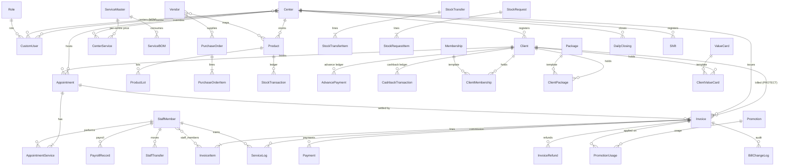

# Aura Salon & Spa POS: Architecture and Business Logic

This document describes the code as it exists today. It is meant to be checked against the owner's intended business logic. It describes the code and changes nothing: no file other than this one was created or modified while writing it.

| | |
|---|---|
| Code snapshot | `Desktop/aftercirapos/aftercirapos/malai-chaap/` (`backend/` and `frontend/`) |
| Written | 2026-10-11 |
| Frontend state | Restored from the 10 Oct backup, plus the approved behaviour and performance fixes from this session |
| Backend state | Includes the SAP integrity changes the owner approved on 2026-10-11. They are **not committed to git and not deployed** to the live server. |

## How to read the labels

Each statement carries one of these labels:

| Label | Meaning |
|---|---|
| **[V]** | Verified: read in the source. The file and line or function are cited. |
| **[T]** | Verified by running the test suite in the sandbox copy, which has SAP switched off. Tests were never run in the real backend, because it posts to live SAP. |
| **[I]** | Inferred: follows from the code, but was not executed, or depends on runtime data or config. |
| **[?]** | Unclear: needs the owner's confirmation of what is intended. |

All paths are relative to `malai-chaap/`. Backend paths start with `backend/` and frontend paths start with `frontend/src/app/`.

---

## Contents

1. [Project overview and technology stack](#1-project-overview-and-technology-stack)
2. [Module and submodule tree](#2-module-and-submodule-tree)
3. [Module-wise documentation](#3-module-wise-documentation)
4. [Page and component functionality](#4-page-and-component-functionality)
5. [Button and action behaviour](#5-button-and-action-behaviour)
6. [Backend functions, services, models and endpoints](#6-backend-functions-services-models-and-endpoints)
7. [Database schema and entity relationships](#7-database-schema-and-entity-relationships)
8. [End-to-end workflows](#8-end-to-end-workflows)
9. [Cross-module dependencies](#9-cross-module-dependencies)
10. [Business rules, calculations, validations, permissions and edge cases](#10-business-rules-calculations-validations-permissions-and-edge-cases)
11. [Frontend → backend → database mappings](#11-frontend--backend--database-mappings)
12. [Configuration, integrations and deployment](#12-configuration-integrations-and-deployment)
13. [Unclear or unverified behaviour, and known defects](#13-unclear-or-unverified-behaviour-and-known-defects)
14. [Coverage report and limitations](#14-coverage-report-and-limitations)

---

## 1. Project overview and technology stack

**What it is.** The system is a multi-branch point-of-sale and back office for a salon chain. Each branch is called a "centre". It covers:

- billing for services, products, memberships, value cards, packages and advances;
- appointments;
- clients and their prepaid entitlements;
- staff, commission, incentives and payroll;
- inventory with purchase orders, goods receipt, transfers and audits;
- marketing: coupons, cashback, memberships, value cards, packages and a WhatsApp mock;
- finance reports, petty cash, daily closing and register shifts;
- an audit trail and internal chat.

Accounting documents go to **SAP Business One** through the Service Layer. Batch numbers are read from **SAP HANA**.

| Layer | Technology | Evidence |
|---|---|---|
| Backend framework | Django 6.1, Django REST Framework 3.18, Channels 4.3 (Daphne/uvicorn ASGI) | `backend/requirements.txt` **[V]** |
| Database (as configured) | SQLite, `backend/db.sqlite3`. The MySQL block in settings is commented out. | `backend/pos_backend/settings.py` DATABASES **[V]** |
| Time | `TIME_ZONE='Asia/Kolkata'`, `USE_TZ=False` (naive local datetimes) | settings **[V]** |
| Auth | DRF token with a 7-day expiry (`ExpiringTokenAuthentication`), plus session auth. Staff and client mobile apps use signed tokens in `X-Staff-Token` / `X-Client-Token`. | settings REST_FRAMEWORK, `staff/views.py:1573-1758`, `clients/app_views.py` **[V]** |
| Default API policy | `IsAuthenticated`. `OptionalPagination` returns every row unless `page`/`page_size` is passed. Throttles: anon 200/h, user 10000/h, login 5/min, staff/client app login 10/min. | settings **[V]** |
| Cache | LocMem, or Redis when `REDIS_URL` is set. Redis is required when `DEBUG=False`. | settings **[V]** |
| Realtime | Channels WebSockets `ws/chat/<room_id>/` and `ws/dashboard/` | `backend/accounts/routing.py:6-7` **[V]** |
| Frontend | Angular 22 standalone components, zoneless (no zone.js), all components `OnPush` with manual `detectChanges()`, lazy routes, Chart.js 4, RxJS 7.8 | `frontend/package.json`, `app.routes.ts` **[V]** |
| Frontend API base | Dev: `http://localhost:8001`. Prod: `API_URL` at build time, else `window.__POS_API_URL__`, else same origin. | `frontend/src/environments/*.ts` **[V]** |
| Deployment target | gunicorn with `uvicorn.workers.UvicornWorker` behind nginx (systemd unit) | `backend/deploy/*` **[V]** |
| SAP | SAP B1 Service Layer (REST, through `requests`). HANA through `hdbcli`, which is imported lazily and is **not** listed in `requirements.txt`. | `backend/pos_backend/sap_utils.py:46` **[V]** |

**Architecture in one line:** the Angular SPA calls the Django REST API with a token. Django writes to SQLite and, after each commit, posts accounting documents to SAP from a background thread. Failures go to a retry queue, and a once-only ledger prevents duplicate postings.

```
Browser (Angular SPA) ──HTTP/JSON (Authorization: Token …)──► Django/DRF ──ORM──► SQLite
        │                                                          │
        └──WebSocket (ws/chat, ws/dashboard)──► Channels           └─on_commit thread─► SAP B1 Service Layer
                                                                   └─HANA (batch lookup)
                                                                   └─SapSyncQueue + SapPosting (retry / post-once)
```

---

## 2. Module and submodule tree

The permission keys come from `backend/pos_backend/permission_tree.json`. The frontend reads an identical copy, `frontend/src/app/services/permission-tree.json`. **[V]**

```
POS
├── FRONTEND  (frontend/src/app)
│   ├── /login ......................... login/login.ts
│   └── /admin  (admin/admin.ts shell — authGuard + roleGuard, app.routes.ts:11-14)
│       ├── home ....................... home/home.ts                         [overview.home – always readable]
│       ├── dashboard .................. dashboard/dashboard.ts               [dashboard.analytics]
│       ├── billing .................... billing/billing.ts                   [billing.invoices, billing.new_invoice]
│       │   ├── components/landing/billing-landing.component.ts
│       │   ├── components/client-search/client-search.ts
│       │   ├── components/invoice-cart/invoice-cart.ts
│       │   ├── components/payment-modal/payment-modal.ts
│       │   └── components/held-carts-modal/held-carts-modal.ts
│       ├── appointments ............... appointments/appointments.ts         [appointments.calendar]
│       ├── staff ...................... staff/staff.ts                       [staff.directory|profile|logs|reports|management|payrolls]
│       ├── inventory .................. inventory/inventory.ts               [inventory.products|vendors|purchase_orders|po_history|checkout|
│       │                                                                       stock_history|audit|stock_transfers|stock_requests|fulfill_stock_requests]
│       ├── marketing .................. marketing/marketing.ts               [marketing.promotions|cards|memberships|packages|whatsapp|usage]
│       ├── finance .................... finance/finance.ts                   [finance.register_summary|monthly_sales|detailed_revenues|refunds|
│       │                                                                       procurement|multi_salon|incentives|pettycash|manage]
│       ├── logs ....................... admin/logs/logs.ts                   [logs.activity]
│       ├── bills ...................... admin/admin-bills/admin-bills.ts     [admin.bills]
│       ├── changes .................... admin/admin-changes/admin-changes.ts [admin.changes]
│       ├── manager-discounts .......... admin/admin-manager-discounts/…      [admin.manager_discounts]
│       ├── centers .................... centers/centers.ts                   [admin.centers]
│       ├── users ...................... users/users.ts                       [admin.users]
│       ├── roles ...................... roles/roles.ts                       [admin.roles]
│       ├── services ................... services/services.ts                 [admin.services]
│       ├── clients .................... clients/clients.ts                   [admin.clients]
│       └── (global) chat widget ....... components/chat/chat.component.ts + chat-websocket.service.ts
│   Shared: services/api.ts (all HTTP calls), auth.ts, session.ts, module-access.ts, permission-tree.ts,
│           money.ts (priceCart), date-util.ts, csv.service.ts, toast.service.ts, admin/admin-filter.service.ts,
│           auth.guard.ts, auth.interceptor.ts, error.interceptor.ts, loading.interceptor.ts,
│           prevent-double-submit.interceptor.ts, components/location-selector, components/toast
│
└── BACKEND  (backend/)
    ├── pos_backend/ ... settings, urls, asgi, permissions.py, scoping.py, money.py, sap_utils.py,
    │                    sap_ledger.py, sap_jobs.py, scheduler.py, deployment_checks.py, models (SapSyncQueue, SapPosting)
    ├── accounts/ ...... CustomUser, login/token, change/reset password, users CRUD, chat (REST + WebSocket)
    ├── salon_admin/ ... Center, Role, dashboards (home + analytics), centre bulk import, SAP branch list
    ├── clients/ ....... Client + held perks (ClientMembership/Package/ValueCard), carry-over, bulk upload, client app API
    ├── appointments/ .. Appointment, AppointmentService, double-booking guard
    ├── services/ ...... ServiceMaster, CenterService (per-centre price/active), ServiceBOM (consumables)
    ├── inventory/ ..... Vendor, Product, ProductLot, PurchaseOrder(+Item), StockTransaction (ledger),
    │                    StockTransfer(+Item), StockRequest(+Item), checkout, audit, stock history, low stock, GRPO
    ├── billing/ ....... Invoice, InvoiceItem, Payment, AdvancePayment, CashbackTransaction, InvoiceRefund,
    │                    BillChangeLog, InvoiceNumberSequence, CheckoutIdempotency; pricing, wallets, services (finalize)
    ├── staff/ ......... StaffMember, Designation, ServiceLog, StaffConsumptionLog, StaffTransfer, PayrollRecord,
    │                    StaffToolTracker, staff app API, revenue/usage/consumption/commission/incentive reports
    ├── finance/ ....... PettyCashEntry, DailyClosing, Shift, IncentiveConfig/Tier (legacy), IncentiveRule, incentives.py, reports
    ├── marketing/ ..... Promotion, PromotionUsage, ValueCard, Membership, Package, WhatsAppMessage; promotions.py
    └── audit_logs/ .... SystemLog + AuditLogMiddleware (records every write request)
```

The root URL prefixes in `backend/pos_backend/urls.py` are `accounts/`, `salon_admin/`, `inventory/`, `marketing/`, `staff/`, `appointments/`, `clients/`, `services/`, `billing/`, `finance/`, `audit_logs/` and `admin/` (Django admin). `media/` is served only when `SERVE_MEDIA_FILES` (default `DEBUG`) is on. **[V]**

---

## 3. Module-wise documentation

Each module below lists its purpose, files, submodules, key functions, inputs and outputs, rules, database tables, APIs, connected modules and user actions. Section 5 covers buttons in more detail, and section 8 covers cross-module flows.

### 3.1 Authentication, session and users (`accounts`)

- **Purpose:** sign-in, the user directory, passwords and the chat transport.
- **Files:**
  - `backend/accounts/models.py` (`CustomUser`:47, `ChatRoom`:71, `Message`:87, `MessageReaction`:131)
  - `backend/accounts/views.py`
  - `backend/accounts/consumers.py` and `routing.py`
  - `frontend/src/app/login/login.ts`, `services/auth.ts`, `services/session.ts`, `auth.guard.ts`, `auth.interceptor.ts`
  - `users/users.ts`
- **Key functions:**
  - `CustomAuthToken.post` (`accounts/views.py:78`) authenticates the user. **[V]** It:
    - deletes and **reissues** the DRF token on every login;
    - runs a **blocking SAP Service Layer login** whose result the frontend does not use;
    - returns the user, role name, permissions and centres.
  - `ChangePasswordView.post`:158 lets users change their own password. `ResetStaffUserPasswordView.post`:203 lets an admin reset another user's password. **[V]**
  - `UserViewSet` (`accounts/views.py:23`) is the user CRUD. `perform_destroy`:70 is a **hard delete**. The Users page only toggles `is_active`. **[V]**
  - Frontend `authGuard` (`auth.guard.ts:19`) requires a stored token. `roleGuard`:35 maps the route to a permission module through `module-access.ts` and `permission-tree.ts` `ROUTE_MODULES` and blocks the route without read access. **[V]**
  - `auth.interceptor.ts` adds `Authorization: Token <t>`. On a **401** (except on the login endpoint) it runs `clearSession()` and redirects to `/login`. **[V]**
  - `error.interceptor.ts` shows a toast for errors, except 401 and status 0 (`SILENT_STATUSES`, line 19). **[V]**
- **Inputs and outputs:**
  - Login takes `{username, password}` and returns `{token, user…}`, stored in `localStorage` keys `token` and `user` (`services/session.ts` `SESSION_KEYS`). **[V]**
- **Rules:**
  - Login is throttled to 5/min.
  - Tokens expire after 7 days.
  - Owner = `is_superuser` or role name `owner`, compared case-insensitively (`pos_backend/permissions.py:18-33`). **[V]**
- **Database:** `accounts_customuser` (M2M `centers`, FK `role`, FK `center`) and `authtoken_token`. **[V]**
- **Connected modules:** every module, through permissions and centre scoping. The SAP login happens at sign-in.
- **User actions:**
  - Log in.
  - Create, edit or deactivate users.
  - Assign a role and centres.

### 3.2 Roles and permissions (`salon_admin.Role`, `pos_backend/permissions.py`)

- **Purpose:** decide what each user may see and do.
- **Data shape:** `Role.permissions` (JSON) is **[V]**:

  ```json
  {"all_centers": true|false,
   "<module>": {"<submodule>": {"read": bool, "create": bool, "update": bool, "delete": bool}}}
  ```

- **Enforcement (backend):** `HasModulePermission` (`permissions.py:107`). **[V]**
  - It maps the HTTP method to a verb: GET→read, POST→create, PUT/PATCH→update, DELETE→delete.
  - A view can override the verb or submodule per action with `permission_action_verbs` / `permission_action_submodules`.
  - Reads are granted at module level: read access to any submodule of the module allows the read.
  - `permission_read_also` / `permission_create_also` let one module's grant open another module's endpoint, for example billing reading services.
  - Owners bypass all checks.
- **Enforcement (frontend):**
  - `roleGuard` and the sidebar use the same tree.
  - Pages also hide tabs by permission. For example, `inventory.ts:217-227` builds the tab list from `permissions.inventory.<sub>.read`. **[V]**
- **Roles page (`roles/roles.ts`):**
  - Edit a role's matrix with per-module "check all" (`toggleModule`, `isModuleFullyChecked`, `isModuleIndeterminate`).
  - Save calls `updateRole` / `createRole`.
  - Delete calls `deleteRole` after a confirm. **[V]**
- **Database:** `salon_admin_role`. **[V]**

### 3.3 Centres / branches (`salon_admin.Center`)

- **Purpose:** branch master data and branch-level settings.
- **Files:** `backend/salon_admin/models.py:18` (`Center`), `salon_admin/views.py` (`CenterViewSet`:30, `bulk_import_centers`:290, `bulk_import_template`:509, `sap_branches_view`:21), `frontend/src/app/centers/centers.ts`. **[V]**
- **Fields set from the UI** (`centers.ts:155-191`) **[V]**:
  - names, address, region and `sap_branch_name`;
  - phones and email;
  - GST and PAN numbers;
  - three owner contacts and two accountant contacts;
  - `monthly_target`.
  - The detail modal adds `monthly_targets_history` (a JSON map from `"Mon-YYYY"` to a target), `closing_sms_recipients` (a list of 10-digit numbers), `credit_limit` and `gst_enabled`.
- **Rules:**
  - Creating or updating a centre queues `create_sap_warehouse` (`salon_admin/views.py:78,88`). **[V]**
  - `gst_enabled=False` makes billing charge 0% tax at that centre (`billing/pricing.py`, `money.ts priceCart`). **[V]**
  - Deactivation is a PATCH of `is_active`. `toggleCenterStatus` asks for confirmation first. **[V]**
  - The SMS number must be exactly 10 characters; this is checked client-side only (`centers.ts:253-261`). **[V]**
- **Connected modules:**
  - Every centre-scoped record.
  - Home: the monthly target gauge, saved by `home.ts saveMonthlyTarget` → PATCH `salon_admin/api/centers/<id>/`.
  - Finance: target-achieved percentages.

### 3.4 Home and dashboard (`salon_admin` dashboard views)

- **Home (`home/home.ts`)** **[V]**:
  - Loads `GET salon_admin/api/dashboard/summary/` for the selected range and again for today.
  - Loads `GET salon_admin/api/dashboard/` (`dashboard_view`, `salon_admin/views.py:124`) for activity and charts.
  - Draws a target gauge (`getGaugePath`).
  - Lets the user save the monthly target.
  - Has quick links (`navigate(route)`).
- **Dashboard (`dashboard/dashboard.ts`)** **[V]**:
  - Six tabs, each with its own endpoint: `summary`, `revenues`, `clients`, `finance`, `services_products` and `staff`, all under `salon_admin/api/dashboard/…`.
  - Revenue and client charts drill down by month and day (`fetchDrillDownData`, `fetchClientDrillDownData`).
  - A chart can be expanded or downloaded as an image.
- **Rules:** the dashboard endpoints require only `IsAuthenticated`, not a module permission, and are centre-scoped server-side. **[V]** (from the earlier backend read)
- **Live updates:**
  - The admin shell subscribes to `ws/dashboard/` (`services/api.ts dashboardUpdates$`).
  - The subscription is lazy, with backoff and shared between subscribers.
  - `billing/views.py:229-243` broadcasts `INVOICE_PAID` on payment. **[V]**

### 3.5 Clients (`clients`)

- **Purpose:** the customer master, the prepaid entitlements each customer holds, and the customer mobile app.
- **Models (`clients/models.py`)** **[V]**:
  - `Client`:6. Phone, names, email, birthday, gender, GST, notes, `dnd_status`, `is_blacklisted` with a reason, `app_pin` (hashed), `center`, `is_active`, and the SAP card code.
  - `ClientMembership`:145, `ClientPackage`:169 and `ClientValueCard`:196. Each links to the marketing template (PROTECT) and its `source_invoice`.
- **Backend (`clients/views.py`)** **[V]**:
  - `get_queryset`:42 returns active clients only, scoped to the user's centres.
  - `perform_create`:125:
    - The phone must be unique per centre (`_find_duplicate`:172).
    - An **archived** duplicate is **reactivated** instead of refused.
    - It queues `create_sap_business_partner`:163/169.
  - `destroy`:212 is a soft delete.
  - `service_history`:219.
  - `carry_over`:238, at `POST …/clients/<id>/carry-over/`, moves or extends a package, value card or membership. The body is `{source_type, source_id, target_id, new_expiry}`.
  - `profile`:295 returns the client's perks.
  - `bulk_upload`:313 uses `bulk_create`. That skips `Client.save()`, so no PIN hashing, no welcome email (`clients/models.py:88-115`) and no SAP business partner.
- **Client app:** `clients/app_views.py`, routes `clients/api/app/{login,data,update_profile,change-pin,contact}`. **[V]**
  - Signed token; the PIN is hashed with `make_password`.
  - `change-pin` verifies the current PIN.
  - `contact` messages are appended to the client's notes.
- **Frontend (`clients/clients.ts`)** **[V]**:
  - Search by phone, with the centre filter.
  - Paginated list; the page arithmetic assumes 50 rows (`loadClients`:84-111).
  - Selecting a client loads invoices, advances, service history and profile.
  - New, Save, Carry-over, Bulk upload (`clients/api/clients/bulk_upload/`), Download CSV template, Export CSV.
  - Required fields are phone and first name (`saveClient`:266-277).
  - It listens for a `clients_updated` event, from the window or `localStorage`, to refresh.

### 3.6 Services catalogue (`services`)

- **Models (`services/models.py`)** **[V]**:
  - `ServiceMaster`:4. The organisation-level service: name, category, default price, duration, GST, incentive fields, M2M `centers`.
  - `CenterService`:32. A per-centre `price` override and `is_active`.
  - `ServiceBOM`:55. Consumable products, by `product_code` and quantity, used per service.
- **Rules:**
  - The effective price at a centre is `CenterService.price`, falling back to `default_price`. **[V]**
  - `ServiceBOM` rows are filled only by the manual `pull_from_sap` management command. **[V]**
  - At checkout the BOM is used to validate and deduct consumable stock (§3.8).
- **API:**
  - `services/api/master/` (CRUD, `bulk_upload`:106).
  - `services/api/center/override/` (`override`:352) sets a centre price or active flag. **[V]**
- **Frontend (`services/services.ts`)** **[V]**:
  - List per centre with an inline price edit (`onPriceChange`, `saveOverride` → `overrideCenterService`).
  - Add or edit a service (`createService` / `updateService`).
  - Delete after a confirm.
  - Bulk upload to the selected centre; `describeImportTargets` reports where rows landed.
  - Template and export.

### 3.7 Appointments (`appointments`)

- **Models:** `Appointment` (`appointments/models.py:5`: centre, client FK, `client_phone`, `client_name`, `date`, `start_time`, `notes`, `status` Scheduled/Completed/Cancelled) and `AppointmentService`:47 (service name, time, duration, price, staff FK). **[V]**
- **Backend (`appointments/views.py`)** **[V]**:
  - Permission: `appointments.calendar` (lines 11-13).
  - `get_queryset`:14. Scoped to the user's centres, and **fails closed** when the user has none. Filters: `center_id`, `date`, `start_date`/`end_date`, `client_phone`, `status`.
  - `_check_double_booking`:67:
    - Rejects overlapping services for the same staff member **within the request**.
    - Rejects overlaps with existing **Scheduled** bookings that day. It locks the `StaffMember` row with `select_for_update`, in sorted order to avoid deadlocks.
    - The default duration is 30 minutes.
  - `perform_create`:176:
    - Checks that the centre is one the user may write to.
    - Refuses a **blacklisted** client, looked up by phone (`.first()`).
    - Runs the double-booking check, then saves.
    - `_link_client` attaches the client by phone.
  - `perform_update`:213 runs the double-booking check **only when `services` is in the payload**. It does **not** repeat the blacklist or centre checks.
- **Frontend (`appointments/appointments.ts`)** **[V]**:
  - Day timeline from 9:00 to 22:00. That is 13 hours (`calculateLeftStyle`:230); a duration over 720 is treated as seconds and the width is capped at 480 minutes.
  - KPIs exclude cancelled appointments (`calculateKPIs`:185).
  - In the modal:
    - client search (2+ characters, 300 ms debounce);
    - recent visits by phone;
    - add services back to back (`addService`:411 takes the price from the centre override, then the default price);
    - `recalculateTimes`:463.
  - Save calls `createAppointment` / `updateAppointment`.
  - Cancel PATCHes `{status:'Cancelled'}`. Restore PATCHes `{status:'Scheduled'}`.
  - **Send to Billing** navigates to `/admin/billing?appointment_id=<id>` and requires a saved appointment (`sendToBilling`:338).

### 3.8 Billing (`billing`), the core module

- **Purpose:** price the cart, take payment, issue the GST invoice, and trigger every downstream effect: stock, perks, wallets, commission, promotions and SAP.
- **Files:**
  - `backend/billing/models.py`:
    - `InvoiceNumberSequence`:15, `Invoice`:59, `Payment`:176, `InvoiceItem`:247;
    - `AdvancePayment`:337, `BillChangeLog`:382, `CashbackTransaction`:400, `InvoiceRefund`:427, `CheckoutIdempotency`:447.
  - `serializers.py`: `InvoiceSerializer._price_invoice`:139, `create`:556, `update`:585.
  - `pricing.py`: `resolve`:159, `reconcile_line_price`:257.
  - `services.py`: `finalize_invoice`:540 and helpers.
  - `wallets.py`.
  - `payment_methods.py`.
  - `views.py`: `InvoiceViewSet`, `AdvancePaymentViewSet`:927, `BillChangeLogViewSet`.
  - Frontend `billing/billing.ts` plus five child components.
  - `services/money.ts` `priceCart`:227. **[V]**
- **Line types:** these are content types on `InvoiceItem` (generic FK, `billing/models.py:251-253`): `services.servicemaster`, `inventory.product`, `marketing.membership`, `marketing.valuecard`, `marketing.package` and `billing.advancepayment`. Package redemptions are zero-value lines with `redeemed_from_package` or the `🎁 [Redeem]` marker (`money.ts:194`). **[V]**
- **Pricing (server, `InvoiceSerializer._price_invoice`, `serializers.py:139`)** **[V]**:
  1. Each line is resolved against the catalogue (`pricing.resolve`):
     - **Products:** price = MRP (or price); tax 0.
     - **Services:** centre price; service GST.
     - **Membership and value card:** tax from `gst_percent`.
     - **Package:** tax from `PACKAGE_GST_PERCENT` (default `'0'`, `settings.py:468`).
     - If the centre has `gst_enabled=False`, tax is 0 on every line.
  2. `reconcile_line_price` (`pricing.py:257-305`) handles the requested unit price.
     - All five sellable types are in `PRICE_OVERRIDE_ALLOWED` (`pricing.py:45-51`), so **any unit price the till sends is accepted**. Only an audit note is written when it differs from the list price.
     - This conflicts with the serializer's stated intent to enforce list prices **[?]** (see §13).
  3. Line taxable value = unit price × qty − line discount, rounded to paise.
  4. The invoice-level discount comes from the request and is **capped at the subtotal**.
  5. Tax is computed per line on the taxable value after the apportioned share of the invoice discount (rounded per line), then summed.
  6. CGST and SGST are an exact split of the tax total (`pos_backend/money.py split`); any odd paisa goes to one half.
  7. Total = subtotal − discount + tax, **rounded to whole rupees**. The difference is stored in `rounding`.
  8. A line discount of at least `DISCOUNT_AUDIT_PERCENT` (default 50, `settings.py:407`) writes a `BillChangeLog` "Price Adjusted" entry.
  - The frontend `priceCart` (`money.ts:227-290`) reproduces steps 3-7 exactly, so the screen matches the stored invoice. **[V]**
- **Invoice statuses:** `draft`, `partial`, `paid`, `cancelled` and `refunded`. **[V]**
  - The POS frontend only creates `draft` (Hold / Save Draft) or `paid`.
  - `saveInvoice` refuses anything other than full payment (`billing.ts` around 2477-2479: "Full payment is required to complete the invoice.").
  - `partial` is reachable only through the API (`pay`, or a direct create with partial payments). **[V]**
- **GST serial number:**
  - Assigned at **finalisation**, not at draft (`services.py:561-563`, `invoice.assign_invoice_number()`).
  - Format `C{center_id}/{FY YYYY-YY}/{n:05d}`, from `InvoiceNumberSequence` per centre and financial year. **[V]**
  - This can exceed GST's 16-character limit (§13).
- **Create (`InvoiceViewSet.create`, `views.py:650`)** **[V]**:
  1. **Idempotency.** The `Idempotency-Key` header (the till generates `till-<random>` once per attempt) is claimed by INSERTing a `CheckoutIdempotency` row, which is unique across processes.
     - A retry with the same key returns **the same invoice** (200).
     - A concurrent duplicate gets **409**.
     - A failure releases the key.
  2. `_create_invoice`:792:
     - A blacklisted client gets 400.
     - The serializer runs, which prices the invoice.
     - The user must be allowed to write to the centre (`assert_can_write_center`).
     - A centre is required for non-owners.
  3. **Stock gate** `_validate_stock_for_items`:745. The service BOM consumables plus product quantities are aggregated per `product_code` and compared with `Product.current_stock` at the centre. A shortfall raises 400 "Not enough stock for consumable …".
  4. If the status is `paid` or `partial`, `finalize_invoice` runs (below), then `BillChangeLog` "Create Bill".
- **Finalisation (`finalize_invoice`, `services.py:540-648`)** **[V]**. It runs once, guarded by `finalized_at` under a row lock, and in this order:
  1. Assign the GST serial number.
  2. Lock the client's active, unexpired packages.
  3. Per line:
     - `_deduct_stock` (SALE ledger rows; an oversell writes AUDIT notes);
     - `_deduct_package_service` (redeem from a package);
     - `_provision_marketing_perks`: create `ClientMembership`, `ClientPackage` or `ClientValueCard`. Memberships stack.
     - For an **advance** line, `wallets.credit_advance` runs and then the SAP advance journal entry. The method recorded is the first non-wallet payment, else Cash.
     - For value card, membership or package lines, the corresponding SAP journal entry.
     - `_create_service_logs`: staff commission rows, scaled by the **real-money ratio** (`_real_money_ratio`:379).
  4. A linked appointment is set to **Completed**.
  5. Wallet and value-card debits for each non-tip payment (`wallets.apply_payment_to_wallets`).
  6. `_enforce_membership_discount`:651 caps a membership-claimed discount at `membership.discount_percent` × the pre-tax total and recomputes the totals.
  7. `apply_promotion` (`marketing/promotions.py:154`) records usage, adds a "Discount" promotion's discount, and awards cashback.
  8. The SAP A/R invoice is queued. After it posts, the incoming payment is posted (`sap_utils.py:1012`).
- **Pay (`pay`, `views.py:156`)** **[V]**:
  - Records one payment.
  - A non-tip payment may not exceed the remaining balance.
  - A tip is recorded separately in `tip_amount`.
  - The status becomes `paid` or `partial`.
  - On the move out of `draft`, the invoice is finalised.
  - On a bill already in SAP, a late part-payment queues an incoming payment.
  - The `INVOICE_PAID` WebSocket event is sent.
  - **The current frontend does not call `/pay/`.** `api.ts payInvoice` exists but is unused. The billing page "Pay" action loads the draft into the cart and re-saves it (PUT). **[V]**
- **Update (`update`, `views.py:868`)** **[V]**:
  - Blocked by the payroll lock, and for cancelled or refunded bills.
  - Changing `items` on a finalised bill is refused ("Cancel it and raise a new bill").
  - A draft that moves to paid or partial is finalised, and `BillChangeLog` "Finalize Bill" is written.
- **Cancel / refund (`cancel`:250, `refund`:306 delegates to it)** **[V]**:
  - A reason is required.
  - Blocked by the payroll lock.
  - The status becomes `cancelled` or `refunded`, and a `BillChangeLog` entry is written.
  - If the bill was paid or partial, an `InvoiceRefund` is created for **paid + tip**, dated today.
  - For a bill that was not a draft, the following are reversed:
    - stock (`_revert_stock`:310);
    - wallets (against the remaining exposure);
    - package redemptions;
    - perks: value cards are deactivated and zeroed; memberships and packages are deleted;
    - promotions: cashback is clawed back, capped at the balance; a cancellation releases the usage allowance.
  - The SAP credit memo is queued.
- **Change payment (`change_payment`:518)** and **apply promo (`apply_promo`:580)** are owner-only or need the update permission. **[V]** (the role gate is from the earlier backend read)
- **Delete:** `destroy`:914 always returns **405**. Invoices are never deleted. `BillChangeLog` updates and deletes also return 405 (`views.py:968-985`). **[V]**
- **Wallets (`billing/wallets.py`)** **[V]**:
  - The advance and cashback balances are **append-only ledgers**.
  - `WALLET_SCOPE` (default `global`, `settings.py:454`) decides whether a balance is usable at any branch.
  - `debit_value_card`:174:
    - Scales the deduction up by face value ÷ post-tax price when the card was sold at a discount.
    - Requires the card to belong to the invoice's client. A walk-in bill without a client is refused.
    - Raises on an insufficient balance.
    - Deactivates the card at zero.
  - `credit_value_card`:224 (refund) returns the **unscaled** amount (§13).
- **Payment methods:** canonicalised by `billing/payment_methods.py` `canonical`:102. Value card IDs come from `"Value Card <id>"` or `value_card_id`. Liability draw-downs are advance, cashback and value card. **[V]**

### 3.9 Inventory (`inventory`)

- **Purpose:**
  - the product master per centre and vendors;
  - purchasing with goods receipt (GRPO);
  - a stock ledger;
  - internal consumption ("checkout");
  - stock audits;
  - inter-branch transfers and requests.
- **Models (`inventory/models.py`)** **[V]**:
  - `Vendor`:4 (M2M `mapped_products`, FK `center`).
  - `Product`:34, belonging to one centre: code, barcode, price (cost), MRP, GST, `current_stock`, reorder level and quantity.
  - `ProductLot`:71.
  - `PurchaseOrder`:91, statuses `Draft → Finalized → Approved → Ordered → Shipped → Partially Received → Delivered`, plus `PurchaseOrderItem`:124 (qty, rate, discount, tax, `received_quantity`, batch, mfg and expiry dates).
  - `StockTransaction`:141. This is the ledger, with types `CHECKOUT`, `AUDIT`, `PO_RECEIPT`, `SALE` and `REFUND`.
  - `StockTransfer`:172, statuses `Draft`, `In Transit` and `Completed`, plus items.
  - `StockRequest`:201, statuses `Pending`, `Fulfilled` and `Cancelled`, plus items.
- **Backend (`inventory/views.py`, `inventory/serializers.py`)** **[V]**:
  - `InventoryBaseViewSet`:21. Scoping applies `center_id` for owners or users with `all_centers`. Others are limited to their centres. `StockTransfer` matches either the source or the target centre.
  - Creating a vendor or product queues SAP vendor or item creation (`views.py:126,368`). A product update queues `update_sap_item` (`views.py:443`).
  - **PO set to `Delivered` by an update:** `PurchaseOrderSerializer.update` calls `_receive_stock` (`serializers.py:238-282`). Each line receives its remaining balance, writes `PO_RECEIPT` ledger rows and queues the SAP GRPO. Items of a delivered PO cannot be edited.
  - **GRPO, partial receipt** `receive_grpo` (`views.py:969-1058`):
    - Refused for a `Draft` or `Delivered` PO.
    - For each line with qty > 0 it adds `received_quantity`, saves the batch and dates, adds stock, creates a `ProductLot` when a batch is given, and writes a `PO_RECEIPT` row.
    - The PO becomes `Delivered` or `Partially Received`.
    - It queues the SAP GRPO.
    - It does **not** cap the received quantity at the ordered quantity.
  - **Checkout (internal use)** `checkout`:781 deducts stock and writes `CHECKOUT` rows, then queues an SAP goods issue (`views.py:814`). **Audit** `audit`:823 sets counted quantities and writes `AUDIT` rows (`views.py:865`). Audit needs the audit permission. **Neither locks product rows**, despite comments saying they do (from the earlier read).
  - `stock_history`:878 reconstructs stock as at a date. `LowStockAlertView`:1114 serves `inventory/api/low_stock/`.
  - **Transfer completion** `StockTransferSerializer._complete_transfer` (`serializers.py:349-397`):
    - Deducts from the source with **no stock floor**, so the source can go negative.
    - Finds the target product by `product_code`, or **clones** the product into the target centre with stock 0 and queues SAP item creation.
    - Adds to the target.
    - Writes a `CHECKOUT` "Stock Transfer Out" row and a `PO_RECEIPT` "Stock Transfer In" row.
    - Queues the SAP inventory transfer.
    - A completed transfer cannot be modified.
  - **Stock request:**
    - Moving to `Fulfilled` needs the `fulfill_stock_requests` permission (`views.py:1086-1094`).
    - "Fulfilled" is only a status; no stock moves. Stock moves through the transfer the user creates.
    - **Scoping defect:** see §13.
- **Frontend (`inventory/inventory.ts`)** **[V]**:
  - The tabs are built by permission (`ngOnInit`:217-227): Checkout, Stock History, Purchase Orders, Product Master, Vendor Master, PO History, GRPO, Stock Transfers, Stock Requests and Audit.
  - With **All Locations** selected, products are aggregated by code, summing stock (`loadData`:272-293).
  - `topLowStock` lists products with stock ≤ reorder level. Fast movers come from `staff/api/reports/usage/`.
  - **PO status:**
    - Status can only move forward (`updatePOStatus`:146-187).
    - Choosing **Delivered** manually is blocked with "Please use the GRPO tab".
    - New POs are created as `Draft` and need a specific centre (`createPurchaseOrder`:641).
  - **GRPO** `submitGRPO`:366 sends only lines with qty > 0.
  - **Transfer** `saveStockTransfer`:410:
    - When the notes start with `Fulfilling Request REQ-<id>`, the request is auto-marked `Fulfilled` after the transfer is created.
    - `fulfillStockRequest`:534 pre-fills a transfer from a request.
  - **Product form:** `onCostOrGstChange`:741 sets MRP = cost × (1 + GST%). With no centre selected the product is created **for all centres** (`create_all_centers`) and updates apply to all centres (`addProduct`:787).
  - **Checkout** refuses quantities above current stock client-side and needs a specific centre (`processCheckout`:936). **Audit** accepts 0 as a valid count (`processAudit`:1048).

### 3.10 Staff, commission, payroll (`staff`)

- **Models (`staff/models.py`)** **[V]**:
  - `StaffMember`:4: centre, designation (text plus `designation_fk`), salary, commission %, product commission %, allocated points, app PIN, image, active.
  - `Designation`:55: default salary and commission.
  - `ServiceLog`:92: commission ledger rows. They are created by billing or entered manually, with an `invoice` FK.
  - `StaffConsumptionLog`:128: a staff perk, paid with Points or Money.
  - `StaffTransfer`:153: Temporary or Permanent.
  - `PayrollRecord`:185: statuses Draft, Locked and Paid.
  - `StaffToolTracker`:250.
- **Backend (`staff/views.py`)** **[V]**:
  - `StaffMemberViewSet`:41. Sensitive fields need the management read permission. The app PIN can only be set by an owner. Other actions: `sync_transfers`:95, the bulk template and upload, `activity_feed`:519, `commission_report`:641 and `incentive_report`:725.
  - `ServiceLogViewSet`:813.
  - `StaffConsumptionLogViewSet`:1001. Creating one deducts **Points first, then Money**. It deducts product stock by **name match** without writing a ledger row (from the earlier read).
  - `StaffTransferViewSet`:1158. Creating a transfer moves `staff.center` immediately. The expiry sync reverts temporary transfers.
  - `StaffToolTrackerViewSet`:1214. Tools are auto-marked Returned when the expected date passes.
  - `PayrollRecordViewSet`:1262:
    - `generate`:1430 is owner-only. It builds **Draft** records for a month from the incentive engine and skips staff whose record is not a Draft.
    - `lock`:1326 is owner-only. It refuses when `net_pay` ≠ the computed components.
    - `unlock`:1357 is owner-only and not allowed for Paid.
    - `mark_paid`:1381 is owner-only and only from Locked.
    - Update and delete are allowed only for a Draft; delete is owner-only.
  - **The payroll lock blocks invoice edits and cancels** for that period (`billing/views.py` `_check_payroll_lock`).
  - Reports: `revenue_report`:885, `usage_report`:956 and `consumption_report`:1111.
  - Staff app: `staff_app_login`:1624 (signed token, `StaffAppLoginThrottle`), plus logs, appointments, tools, transfers and update_profile.
- **Frontend (`staff/staff.ts`)** **[V]**:
  - Directory with a location filter and an activity feed.
  - The profile autosaves **each field on change** (`updateStaffField`:325). Changing the designation also copies its salary and commission percentages.
  - Add staff, add a service log or perk consumption (`saveNewLog`:634), image upload, toggle active, delete (with confirm).
  - Designations modal.
  - Management tab: tools and transfers. `saveTransfer`:793 creates the transfer **and then PATCHes `staff.center`** itself, which repeats the backend's move.
  - Payroll tab: **list, Lock and Mark Paid only**. The frontend has no Generate or Unlock button; `services/api.ts` has no such call.
  - Reports: revenue, usage, commission, perks, tools, transfers and incentives (by month, with an editable salary). All export to CSV.

### 3.11 Finance (`finance`)

- **Models (`finance/models.py`)** **[V]**:
  - `PettyCashEntry`:4.
  - `DailyClosing`:21, unique per (centre, date). Fields: opening balance, `system_cash`, expenses, cash in hand, difference, deposit, closing balance, and nine payment-method totals.
  - `IncentiveConfig`/`IncentiveTier`:59/74 (legacy).
  - `Shift`:94: Open/Closed, float, expected, actual, variance.
  - `IncentiveRule`:122: category, centre (null = all), role, frequency, tiers or slabs JSON, active, validity.
- **Backend (`finance/views.py`)** **[V]**:
  - **Daily closing** `DailyClosingViewSet.create`:341:
    - A second closing for the same centre and date returns **409** for non-owners.
    - An **owner may overwrite** it; the previous figures are first saved to `SystemLog` (`_log_closing_amendment`).
    - `opening_balance`:469 carries forward the **last earlier closing's** `closing_balance` across gaps and reports `days_since_last_closing`.
    - All amounts are taken from the client.
  - **Shift** `ShiftViewSet` (permission `finance.manage`):
    - Create opens a shift (`status='Open'`).
    - `close_shift`:561 stores the **client-supplied** `expected_cash` and `actual_cash`, with variance = actual − expected.
  - **Incentive rules** `IncentiveRuleViewSet`:579. `duplicate`:641 **ignores `target_center_id`** (from the earlier read).
  - **Reports:**
    - `RegisterSummaryView`:962: billed vs collected, payment-method buckets, liability draw-downs, refunds by `refunded_on`, `expected_settlement`, cached for 60 seconds.
    - `MonthlySalesView`:1011, `DetailedRevenuesView`:1339 (paged), `RefundsView`:1539, `ProcurementReportView`:1674.
    - Tax:1765, Service drilldown:1809, Staff performance:1859, `ManagerDiscountsAuditView`:1910, `StaffIncentiveCalculationView`:1944.
    - Multi-salon views:2119-2858.
    - Reports default to the current month.
- **Incentive engine (`finance/incentives.py`)** **[V]**:
  - `select_rule`:189 picks a rule by precedence: centre-specific first, then the most specific role (`_role_specificity`:156), then the newest.
  - `highest_qualifying_tier`:86: the highest tier whose threshold is met wins.
  - The base is the **tax-exclusive line value × the invoice's real-money ratio** (`real_money_ratio`:463), so paying with wallets or redemptions earns proportionally less. Staff allocation weights are honoured (`credited_staff`:453).
  - Fallbacks: the staff member's own rate, then the item master value (`_item_master_incentive`:664).
  - Add-ons (`addon_reward`:296) and service targets (`_service_targets`:783) are additive. The daily-business slab bonus is `_slab_bonus`:766.
- **Frontend (`finance/finance.ts`)** **[V]**:
  - Main tabs are chosen by permission (`ngOnInit`:600-632):
    - **single**: register, monthly, detailed, refunds, procurement;
    - **multi**: per-centre register summaries via `forkJoin`, sorted by target achievement ascending, plus balances, categories, drilldowns, petty cash, clients and staff;
    - **incentives**;
    - **pettycash**: closing and shift;
    - **manage**: incentive rules.
  - Date pills; the default is this month.
  - **Closing screen** (`loadTodayClosingData`:1594):
    - The opening balance comes from the API, or from the open shift's float.
    - "Day's collection" = the **cash** bucket of the register summary for that date.
    - The getters compute: expected cash = opening + collection − expenses; difference = cash in hand − expected; closing balance = expected − deposit.
  - **Submit closing** (`submitClosing`:1698) sends opening, cash in hand, expenses, deposit, closing balance and the nine method totals. It does **not** send `system_cash` or `difference`, and the serializer does not compute them, so they are stored as **0**.
  - **Close register** (`closeShift`:1683) closes the shift with the screen's expected cash, then submits the daily closing.
  - "Export closing history" shows "coming soon".

### 3.12 Marketing (`marketing`)

- **Models (`marketing/models.py`)** **[V]**:
  - `WhatsAppMessage`:11.
  - `Promotion`:39: level Organisation/Center, `promo_type` Discount/FlatPrice/Trigger/Cashback, `discount_type`, `discount_value`, a `config` JSON, `members_only`, `max_usage_per_client`, start and end dates, active.
  - `PromotionUsage`:72: unique per (promotion, invoice), with `releases_allowance`.
  - `ValueCard`:127: pre-tax and post-tax price, face `value`, benefit %, GST, validity.
  - `Membership`:169: prices, value, `discount_percent`, validity.
  - `Package`:213: `services_json`, price, validity days.
- **Backend (`marketing/views.py`)** **[V]**:
  - `MarketingBaseViewSet`:27 shows organisation-level items plus the user's centres.
  - `destroy`:28 returns **409** if customers hold the template.
  - `toggle-status`:179.
  - `send_campaign`:198 is a **mock**: messages are stored as "Sent (Mock)" and nothing is sent.
  - `PromotionViewSet.usage_report`:346 counts sold, used and holders.
  - Promotion start dates may not be in the past (from the earlier read).
- **Promotion rules (`marketing/promotions.py`)** **[V]**:
  - `check_promotion`:38 checks:
    - the promotion is active;
    - the date window, using the invoice date;
    - the centre match;
    - members-only (`_client_is_member`, an active unexpired membership);
    - the per-client limit (it locks the **client row** and excludes usages that released their allowance);
    - for a Discount promotion, that the value is set, > 0 and ≤ 100%.
  - `compute_discount`:101 applies **only to `promo_type == 'Discount'`**, always on the **whole subtotal**. The `config.target = 'Specific Service'` and `min_bill_amount` settings used by the till are **not applied server-side**.
  - `_award_cashback`:121 credits the configured % of the post-discount taxable amount, applying `cashback_min_bill` and an optional `cashback_max`.
- **Frontend (`marketing/marketing.ts`)** **[V]**:
  - Creation forms for promotions, cards, memberships and packages. Org vs centre level is chosen with `getCreateCenterId`.
  - Price calculators: post-tax ↔ pre-tax, and benefit % ↔ face value, as value = post-tax × (1 + benefit%).
  - A package is created from **one service** with a quantity (`addPackage`:472-512 builds `services_json` with one entry).
  - Toggle status, delete (with confirm), edit modal.
  - Usage report with CSV export.
  - WhatsApp campaign send (`sendCampaign`:737, with confirm).

### 3.13 Admin review pages: Bills, Changes, Manager Discounts

- **Bills (`admin/admin-bills/admin-bills.ts`)** **[V]**:
  - `GET billing/invoices/` with the centre and date range from the shared filter (`admin-filter.service.ts`), an invoice number search, `exclude_drafts=true`, `page_size=500`.
  - An invoice modal with **Cancel** or **Refund**, each needing a reason, and per-payment **change method** (`change_payment`).
  - CSV export and the totals strip (paid, cancelled and refunded counts).
- **Changes (`admin/admin-changes/admin-changes.ts`)** **[V]**:
  - `GET billing/change-logs/?center_id&start_date&end_date`.
  - Counts cancels and refunds and the "lost value".
  - CSV export.
- **Manager discounts (`admin/admin-manager-discounts/…`)** **[V]**:
  - `GET billing/invoices/?manager_discount=true&…`.
  - Lists invoices with an invoice-level discount, with totals and CSV export.
  - The backend's `ManagerDiscountsAuditView` labels the invoice's staff as the "manager" **[?]**.

### 3.14 Activity logs (`audit_logs`)

- **Backend:**
  - `AuditLogMiddleware` (`audit_logs/middleware.py:537`) records **every write request**, including failed ones, **asynchronously** (`BoundedExecutor`). It stores the user (token or session), staff or client token, module and entity, entity ID, a human description, the **redacted** body (`_redact`, `_is_sensitive_key`), IP, user agent and geo (`_cached_geo`). **[V]**
  - `SystemLog` (`audit_logs/models.py:5`). `SystemLogViewSet` provides `facets`, `users` and `summary` actions. **[V]**
- **Frontend (`admin/logs/logs.ts`)** **[V]**:
  - Filters: module pills, multi-action, user, date and search.
  - Paging.
  - Payload pretty-print.
  - **For public IPs the browser calls `https://ipapi.co/<ip>/json/`** to resolve geography (`resolveLocation`:465-527). This is an outbound third-party call from the user's browser.

### 3.15 Internal chat (`accounts` chat + `components/chat`)

- **Backend:**
  - REST endpoints:
    - `accounts/api/chat/users/` (`ChatUserListView`:230);
    - `chat/unread/`;
    - `chat/messages/` (`MessageViewSet`:356, cursor-paginated, `mark_read`:404, image upload via multipart);
    - `chat/reactions/`.
  - REST image messages are broadcast to the room (`broadcast_chat_message`:312).
  - WebSocket `ws/chat/<room_id>/` checks token expiry and room membership (from the earlier read). **[V]**
- **Frontend:**
  - `chat.component.ts` is a floating widget: rooms, messages with load-more, typing, reactions, reply, delete and read receipts.
  - `chat-websocket.service.ts` derives the WS origin from the API URL (lines 92-110) and reconnects with backoff (`scheduleReconnect`:200).
  - The same-origin double-submit guard **does not** apply to `/chat/` (`prevent-double-submit.interceptor.ts` `NEVER_DEDUPE`). **[V]**

### 3.16 SAP integration (`pos_backend/sap_utils.py`, `sap_ledger.py`, `sap_jobs.py`, `scheduler.py`)

- **Purpose:** mirror POS business events into SAP Business One.
- **Trigger → document map** **[V]**:

  | POS event | Trigger (file:line) | SAP function → document |
  |---|---|---|
  | Client created or reactivated | `clients/views.py:163,169` | `create_sap_business_partner` → Business Partner |
  | Centre created or updated | `salon_admin/views.py:78,88` | `create_sap_warehouse` → Warehouse |
  | Vendor created | `inventory/views.py:126,287` | `create_sap_vendor` → Vendor BP |
  | Product created, updated or cloned by a transfer | `inventory/views.py:368,443`, `serializers.py:373` | `create_sap_item` / `update_sap_item` → Item |
  | Invoice finalised | `billing/services.py:645` | `create_sap_invoice` → A/R Invoice, then `create_sap_incoming_payment` (`sap_utils.py:1012`) |
  | Late part-payment on a posted bill | `billing/views.py:225` | `create_sap_incoming_payment` (only payments SAP lacks) |
  | Value card, membership or package sold | `billing/services.py:612-618` | `create_sap_valuecard_je` / `_membership_je` / `_package_je` → Journal Entry |
  | Advance sold or received | `billing/services.py:605`, `views.py:966` | `create_sap_advance_je` → JE |
  | Value card redeemed as payment | inside incoming payment (`sap_utils.py:2029`) | `create_sap_valuecard_redemption_je` → JE |
  | Invoice cancelled or refunded | `billing/views.py:299` | `create_sap_credit_note` → A/R Credit Memo |
  | Stock revert on cancel, checkout or audit | `billing/views.py:372`, `inventory/views.py:814,865` | `create_sap_stock_transaction` → Goods Issue/Receipt. Rows already covered by another document are marked synced **without posting**. |
  | PO delivered or GRPO | `inventory/serializers.py:282`, `views.py:1058` | `create_sap_purchase_delivery_note` → GRPO, keyed per receipt |
  | Transfer completed | `inventory/serializers.py:397` | `create_sap_stock_transfer` → Inventory Transfer |

- **Mechanics (the 2026-10-11 changes, uncommitted)** **[V][T]**:
  - `run_sap_sync_async`:103 runs the function in a background thread **after commit** (`transaction.on_commit`). On failure, or when SAP is disabled, it enqueues the job in `SapSyncQueue`.
  - `sap_ledger.post_once(key, …)` records each document in `SapPosting` (unique `key`, for example `invoice:<id>`, `creditnote:<id>`, `je:advance:<id>`, `inpay:<inv>:ar:<n>`, `grpo:<id>:<ref>`, `transfer:<id>`, `stocktxn:<id>`).
  - On a retry, the ledger first **looks the document up in SAP** by its Comments or Remarks reference, so a document is never posted twice.
  - `sap_jobs.process_due` claims queue rows with a conditional UPDATE.
  - `scheduler.start_scheduler` runs **one** retry worker, only in a real server process, and only when `SAP_ENABLED` and `SAP_SCHEDULER` are on. A database lease enforces the single worker.
  - Credentials come from `.env` (`SAP_*` and `HANA_*`). `SAP_CONFIGURED`/`SAP_ENABLED` act as the kill switch. Deployment checks W009 and W010 warn when SAP is unconfigured or disabled.
  - Tests: 31 tests in `pos_backend/tests_sap_integrity.py` pass in the sandbox. **[T]**
- **HANA:** `get_hana_batches`:31 picks batches for an item and warehouse. It returns `[]` when SAP is off and closes its connection.

### 3.17 Mobile app APIs (staff and client)

- **Staff app** (`staff/views.py:1573-1758`) **[V]**:
  - Login with a PIN gives a signed token, verified by `_verify_staff_token`.
  - Endpoints: own service logs, appointments, tools and transfers, and profile update.
  - Login is throttled.
- **Client app** (`clients/app_views.py`, `clients/urls.py:14-21`) **[V]**:
  - Login with phone and PIN gives a signed token.
  - `data`: profile, perks and history (from the earlier read).
  - `update_profile`, which no longer accepts a PIN.
  - `change-pin`: verifies the old PIN, hashes the new one and reissues the token.
  - `contact`: appended to the client's notes.

---

## 4. Page and component functionality

| Page / component | File | What it shows and does | Data loaded on open |
|---|---|---|---|
| Login | `login/login.ts` | Username and password form. Stores the token and user, then routes to `/admin/home`. | none |
| Admin shell | `admin/admin.ts` | Sidebar filtered by permission, the centre and date filter shared by admin pages (`admin-filter.service.ts`), low-stock and notification polling, and the live dashboard socket. Logout calls `clearSession`. | centres; low stock (every 10th poll tick); `ws/dashboard/` |
| Location selector | `components/location-selector/location-selector.ts` | Emits the chosen centre ID, or `null` for All Locations (`selectCenter`:29). | from the parent |
| Toast | `components/toast/toast.ts` + `services/toast.service.ts` | Success, error and info messages. | n/a |
| Home | `home/home.ts` | Month and today KPIs, target gauge, monthly target edit, revenue chart, activity, quick links. | `dashboard/summary` ×2, `dashboard/` |
| Dashboard | `dashboard/dashboard.ts` | Six analytics tabs with Chart.js, drill-down, expand and download. | `dashboard/<tab>/` per tab |
| Billing (landing) | `billing/components/landing/billing-landing.component.ts` | Today's invoices (`globalInvoices`) and appointments, staff activity, activity feed. Clicking an invoice opens it; drafts can be deleted. | invoices, appointments, staff, activity |
| Billing (new invoice) | `billing/billing.ts` + `billing.html` | Client panel, catalogue tabs (services, products, memberships, cards, packages, advance, custom package), the item config drawer (staff selection with % allocation, price, qty, discount), the cart, promotions and memberships, totals from `priceCart`, checkout. | services, products and marketing templates per centre; client perks on select |
| Client search | `billing/components/client-search/client-search.ts` | Phone or name search. Emits `onSelectClient`, `newClient` or `anonymousClient`. | `getClients` |
| Invoice cart | `billing/components/invoice-cart/invoice-cart.ts` | Displays the cart lines and totals. | from the parent |
| Payment modal | `billing/components/payment-modal/payment-modal.ts` | Payment rows (method and amount), the tip, wallet and value-card balances, Complete Sale. The overlay only closes when the press started on it (`overlayPressed`). | from the parent |
| Held carts modal | `billing/components/held-carts-modal/held-carts-modal.ts` | Lists carts held in `localStorage` (`held_carts`): resume or delete. | `localStorage` |
| Appointments | `appointments/appointments.ts` | Day timeline by staff (9:00-22:00), KPIs, show-cancelled toggle, booking modal. | services, staff, appointments for the date |
| Clients | `clients/clients.ts` | Paged client list, profile with timeline, perks (packages, cards, memberships) with progress, carry-over modal, edit form. | centres, clients; on select: invoices, advances, service history, profile |
| Services | `services/services.ts` | Catalogue per centre, inline price and active override, add/edit modal, bulk upload. | centres, services |
| Inventory | `inventory/inventory.ts` | Ten tabs (see §3.9), KPIs (stock value, low stock, fast movers), lots, vendor mapping, stock history by date. | usage report, products, vendors, POs, transfers, requests, transactions |
| Staff | `staff/staff.ts` | Directory, profile (autosave), logs by date preset, management, payrolls, reports and modals. | centres, designations, staff, activity feed, clients and services |
| Finance | `finance/finance.ts` | Single, multi-salon, incentives, petty cash and closing, rule manager. | depends on the tab (§3.11) |
| Marketing | `marketing/marketing.ts` | Campaign lists (org vs centre), creation forms with price calculators, usage report, WhatsApp. | WhatsApp messages, promotions, cards, memberships, packages, services |
| Bills | `admin/admin-bills/admin-bills.ts` | Non-draft invoices with cancel, refund and change-payment. | `billing/invoices/?exclude_drafts=true&page_size=500` |
| Changes | `admin/admin-changes/admin-changes.ts` | Bill change log. | `billing/change-logs/` |
| Manager discounts | `admin/admin-manager-discounts/…` | Discounted invoices. | `billing/invoices/?manager_discount=true` |
| Logs | `admin/logs/logs.ts` | Audit trail explorer. | `audit_logs/logs/`, `facets`, `users` |
| Centres | `centers/centers.ts` | Centre list (active/inactive), add/edit modal, detail modal (targets, SMS, credit limit, GST), bulk import. | centres; `salon_admin/api/sap-branches/` |
| Users | `users/users.ts` | User list, add/edit with role and multiple centres, activate/deactivate. | users, roles, centres |
| Roles | `roles/roles.ts` | Role list and permission matrix editor. | roles |
| Chat | `components/chat/chat.component.ts` | Floating chat (§3.15). | rooms on open; messages per room |

**Cross-cutting HTTP behaviour (frontend)** **[V]**:

- `loading.interceptor.ts` drives the global loading indicator.
- `prevent-double-submit.interceptor.ts` blocks a second identical POST, PUT or PATCH **while the first is still in flight**. The blocked request errors; it does not reuse the other response. FormData requests and `/chat/` and `/api/login` are never de-duplicated.
- `auth.interceptor.ts` adds the token and handles 401 (§3.1).
- `error.interceptor.ts` turns errors into toasts.

---

## 5. Button and action behaviour

Format: **Button / trigger** → handler → client-side checks → API call → effect. All are **[V]** unless marked otherwise.

### 5.1 Billing

| Button / trigger | Handler (`billing/billing.ts`) | Checks | API | Effect |
|---|---|---|---|---|
| New Invoice | `openNewInvoice`:590 | none | none | Clears the cart, client, totals and saved draft; switches to the new-invoice view. |
| Select client (search result) | `selectClient` | Blacklisted clients are flagged | `clients/api/clients/<id>/`, `billing/invoices/?client_id=` (`loadClientHistory`:775), perks | Loads perks. Injects membership pseudo-promotions (`m_<id>`, auto-applied) and "🎁 [Redeem]" services from packages. |
| Save client (inline form) | `saveClient`:923 | First name and phone required | `updateClient` / `createClient` | Creates or updates the client. |
| Gender buttons | inline | none | none | Sets `client.gender`. |
| Catalogue item (service, product, membership, card, package, custom package) | `openConfig(item, type)` | none | none | Opens the config drawer. |
| Staff chip | `toggleStaffSelection(id)` | left mouse button only | none | Toggles staff and splits the allocation. |
| Add to cart | `confirmAddToCart`:1672 | At least one staff member (except advance); allocations must sum to **100% ± 0.1** | none | Adds the line; totals are recalculated with `priceCart`. |
| Redeem from package | `addRedeemableServiceToCart`:1867 | Remaining count > 0 | none | Adds a zero-price `🎁 [Redeem]` line. |
| Qty +/−, Remove | `updateQuantity(i,±1)`, `removeFromCart(i)` | none | none | Recalculates totals. |
| Promotion select / clear | `selectPromotionWithFeedback` / `clearPromotion`:1345 → `applyPromotion` | Promotion config | none | Sets `invoiceDiscount` client-side: percentage or flat, overall or a specific service, capped at the pre-tax subtotal; **products are excluded** from the discountable subtotal. |
| Apply value-card discount | `applyValueCardDiscount`:731 | Client has active cards | none | Takes the card with the highest balance. Sets `invoiceDiscount` = face value usable − its pre-tax cash equivalent. **The card balance is not consumed by this action [?]** (§13). |
| Hold / Save Draft | `saveInvoice(true)`:2446 | Client selected (or anonymous) | `POST billing/invoices/` (`status:'draft'`, no payments), or PUT when editing | Server draft. No GST serial number, no stock or perk effects. |
| Checkout (also F8 / Ctrl+Enter) | `openCheckoutModal` | Cart not empty; F8 also needs a non-anonymous client | none | Opens the payment modal; Cash is the default row. |
| Add or remove payment row, method, amount, tip | payment modal outputs | none | none | Recalculates `checkoutRemaining`. |
| Complete Sale | `saveInvoice(false)`:2446 | Client required; remaining must not be < 0 ("exceeds the total due"); remaining must not be > 0 ("Full payment is required"); a value-card row needs a card | `POST billing/invoices/` with `Idempotency-Key: till-<random>` (or PUT for a loaded draft); body includes items, totals, `promo_id`, `membership_id`, `appointment`, payments, tip | Server prices, finalises and posts (§3.8). The success modal shows the receipt (`handlePostSave`:2604). |
| Print | `printInvoice`:49 | none | none | `window.print()`. |
| Discard (current draft) | `discardInvoice`:605 | none | `DELETE billing/invoices/<id>/` → **405** | Errors are swallowed; the local state is cleared and **the server draft remains**. |
| Delete draft (landing) | `deleteDraftInvoice` (~515) | Confirm | `DELETE` → **405** | Toast "Failed to delete draft invoice." |
| Open invoice (landing) | `viewInvoice`:2738 / `payInvoice`:2661 → `loadInvoice` | Only drafts can be loaded into the cart | `GET billing/invoices/<id>/` | View the receipt, or load a draft and open checkout. |
| Held carts | `showHeldCartsModal = true`; resume and delete in the modal | none | none | `localStorage` only. `holdCurrentCart`:2267 exists, but **no button calls it**, so nothing new is ever held **[V]**. |
| F2 / F4 / Esc / scanner | `@HostListener('window:keydown')`:2069 | none | Barcode: `processBarcode` searches products, then services | F2 focuses client search; F4 focuses service search; Esc closes the modal or config, or asks before clearing the cart; a fast keystroke burst ending in Enter is treated as a barcode and opens the item's config. |
| From appointment | route `?appointment_id=` | none | appointment fetch | Pre-fills the client and services at the appointment's prices; checkout links `appointment`. |

### 5.2 Appointments

| Button | Handler (`appointments.ts`) | Checks | API | Effect |
|---|---|---|---|---|
| ◀ / ▶ / Today | `prevDay` / `nextDay` / `setToday` | none | `GET appointments/api/appointments/?center_id&date` | Reload. |
| New appointment | `openNewModal`:276 | none | none | Blank modal: 09:00, Scheduled, current centre. |
| Client search input | `onSearchInput`:305 | ≥ 2 characters, 300 ms debounce | `getClients(q)` | Results list. |
| Select client | `selectClient`:323 | **Blacklisted → alert and stop** | `getAppointments(center, –, phone)` | Fills the name and phone; shows recent visits. |
| Add service | `addService`:411 | A service must be chosen | none | Price = centre override, then default; duration from the master; time chained after the previous service. |
| Remove service | `removeService(i)`:449 | none | none | Re-chains the times. |
| Save | `saveAppointment`:496 | Name, phone and ≥ 1 service; not blacklisted | `POST` / `PUT appointments/api/appointments/` | Server checks double booking and blacklist (§3.7). |
| Cancel appointment | `cancelAppointment`:545 | Edit mode | `PATCH {status:'Cancelled'}` | Kept in the list as Cancelled. |
| Restore | `restoreAppointment`:563 | Edit mode | `PATCH {status:'Scheduled'}` | **No double-booking check** (no `services` in the payload) **[V]**. |
| Send to Billing | `sendToBilling`:338 | Must be saved | none | Navigates to billing with `appointment_id`. |

### 5.3 Clients

| Button | Handler (`clients.ts`) | Checks | API |
|---|---|---|---|
| Search / centre filter / page | `searchClient`, `onCenterChange`, `nextPage`/`prevPage` → `loadClients`:84 | none | `GET clients/api/clients/?phone&center_id&page` |
| Row click | `selectClient`:132 | none | invoices, advances, `service_history`, `profile` |
| New / Save | `newClient`:248 / `saveClient`:266 | Phone and first name | `POST` / `PUT clients/api/clients/` |
| Carry over (package, card, membership) | `openCarryOver`:194 → `submitCarryOver`:202 | none | `POST clients/api/clients/<id>/carry-over/` |
| Upload | `uploadClients`:324 | file | `POST clients/api/clients/bulk_upload/` |
| Template / Export | `downloadTemplate`:343 / `exportExcel`:348 | none | none (CSV in the browser) |

### 5.4 Inventory

| Button | Handler (`inventory.ts`) | Checks | API |
|---|---|---|---|
| PO status step | `updatePOStatus`:146 | Forward only; **Delivered blocked** | `PATCH inventory/api/purchase-orders/<id>/ {status}` |
| Create / Update PO | `createPurchaseOrder`:641 | Specific centre, vendor, ≥ 1 item | `POST` / `PUT …/purchase-orders/` (status `Draft`) |
| Edit / Delete PO | `editPO`:707 / `deletePO`:725 | Confirm before delete | `DELETE …/purchase-orders/<id>/` |
| Receive (GRPO) | `submitGRPO`:366 | ≥ 1 qty > 0 | `POST …/purchase-orders/<id>/receive_grpo/` |
| Save product | `addProduct`:787 | none | `POST` / `PUT …/products/` (`create_all_centers` / all-centre update when no centre is selected) |
| Delete product / lot | `deleteProduct`:749 / `deleteLot`:779 | Confirm | `DELETE …/products/<id>/`, `…/lots/<id>/` |
| Add lot | `addProductLot`:760 | none | `POST …/lots/` |
| Save / delete vendor, map products | `addVendor`:857, `deleteVendor`:849, `toggleVendorMapping`:837 | Confirm before delete | `…/vendors/` |
| Checkout (consume) | `processCheckout`:936 | Specific centre; 0 < qty ≤ stock | `POST …/products/checkout/` |
| Submit audit | `processAudit`:1048 | Specific centre; ≥ 1 count (0 allowed) | `POST …/products/audit/` |
| Create transfer | `saveStockTransfer`:410 | From and to centres; valid items | `POST …/stock_transfers/` (+ auto-fulfil the request) |
| Transfer status | `updateStockTransferStatus`:457 | none | `PATCH …/stock_transfers/<id>/ {status}` (Completed moves stock) |
| Create request / set status / fulfil | `saveStockRequest`:487 / `updateStockRequestStatus`:521 / `fulfillStockRequest`:534 | Valid items | `POST` / `PATCH …/stock_requests/` |
| Stock history (view / download) | `viewStockHistoryForDate`:1124 / `downloadStockHistoryExcel`:1108 | none | `GET …/products/stock_history/?date&center_id` |
| Uploads / templates / exports | `uploadProducts`:1192, `uploadVendors`:990, `downloadTemplate`:1225, `downloadVendorTemplate`:970, `exportExcel`:1245, `exportLowStockExcel`:1163 | file | `…/bulk_upload/`, `…/bulk_upload_template/` |

### 5.5 Staff

| Button | Handler (`staff.ts`) | API |
|---|---|---|
| Any profile field change | `updateStaffField`:325 | `PATCH staff/api/members/<id>/ {field}` (+ salary and commission when the designation changes) |
| Add staff | `saveNewStaff`:590 | `POST staff/api/members/` |
| Delete / toggle active | `deleteStaff`:363 (confirm) / `toggleActive`:442 | `DELETE` / `PATCH …/members/<id>/` |
| Photo | `onImageUpload`:427 | `uploadStaffImage` (multipart) |
| Add service log / perk consumption | `saveNewLog`:634 | `POST staff/api/logs/` / `POST staff/api/consumptions/` |
| Transfer | `saveTransfer`:793 | `POST staff/api/transfers/` then `PATCH …/members/<id>/ {center}` |
| Tool / mark returned | `saveTool`:848 / `markToolReturned`:869 | `POST` / `PATCH staff/api/tools/` |
| Lock payroll / mark paid | `lockPayroll`:478 / `markPayrollPaid`:495 (confirm) | `POST staff/api/payrolls/<id>/lock/` / `…/mark_paid/` |
| Designations add / delete | `saveDesignation`:198 / `deleteDesignation`:210 | `staff/api/designations/` |
| Reports (revenue, usage, commission, perks, tools, transfers, incentives) and exports | `open*Report`, `load*Report`, `export*Excel` | `staff/api/reports/*`, `…/members/commission_report/`, `…/members/incentive_report/` |
| Edit salary in the incentive report | `updateStaffSalary`:911 | `PATCH …/members/<id>/ {salary}`, then the report reloads |

### 5.6 Finance

| Button | Handler (`finance.ts`) | API |
|---|---|---|
| Tab or date change | `setMainTab`:753, `setSingleTab`:791, `setDateRange`:690, `onApplyFilter`:742 | the matching report endpoint (§6) |
| Open register | `openShift`:1666 (float ≥ 0) | `POST finance/api/shifts/` |
| Close register | `closeShift`:1683 | `POST finance/api/shifts/<id>/close_shift/ {actual_cash, expected_cash}`, then `submitClosing` |
| Submit closing | `submitClosing`:1698 | `POST finance/api/daily-closing/` (409 if one exists and the user is not an owner) |
| Petty cash add / edit | `submitPettyCash`:1510 / `editPettyCash`:1557 | `POST` / `PUT finance/api/petty-cash/` |
| Rule create / edit / toggle / delete / duplicate | `saveRule`:364, `toggleRuleStatus`:429, `deleteRule`:440 (confirm), `confirmDuplicateRule`:351 | `finance/api/rules/` (+ `/duplicate/`) |
| Exports | `exportExcel`:839, `exportIncentives`:1132, `downloadMultiSales`:1228, `exportMulti*` | browser CSV, or `finance/api/reports/multi_salon/sales_export/` |

### 5.7 Marketing, admin pages, centres, users, roles and services

| Button | Handler | API |
|---|---|---|
| Create promotion / card / membership / package | `addPromotion`:364 / `addCard`:416 / `addMembership`:446 / `addPackage`:472 | `POST marketing/api/{promotions,cards,memberships,packages}/` |
| Toggle / delete / edit campaign | `toggleStatus`:514 / `deleteCampaign`:547 (confirm) / `saveEdit`:609 | `PATCH …/<id>/toggle-status/`, `DELETE` (409 if held), `PUT` |
| Send WhatsApp campaign | `sendCampaign`:737 (confirm) | `POST marketing/api/whatsapp/send_campaign/` (mock) |
| Usage report | `fetchUsageData`:83 | `GET marketing/api/promotions/usage_report/` |
| Bills: Cancel / Refund | `confirmAction` → `executeAction`:181 (reason required) | `POST billing/invoices/<id>/cancel/` or `/refund/` |
| Bills: change payment method | `updatePaymentMethod`:220 | `POST billing/invoices/<id>/change_payment/ {payment_id, payment_method}` |
| Centres: save / activate-deactivate / target / SMS / credit limit / GST / import | `onSubmit`:374, `toggleCenterStatus`:269 (confirm), `updateTarget`:247, `addSms`:253, `removeSms`:263, `updateCreditLimit`:283, `toggleGst`:287, `runImport`:330 | `POST` / `PATCH salon_admin/api/centers/`, `…/centers/bulk-import/` |
| Users: save / activate-deactivate | `onSubmit`:186, `toggleUserStatus`:125 (confirm) | `POST` / `PATCH accounts/api/users/` |
| Roles: save / delete | `saveRole`:92, `deleteRolePrompt`:125 (confirm) | `salon_admin/api/roles/` |
| Services: save / delete / price override / upload | `addService`:180, `deleteService`:142 (confirm), `saveOverride`:105, `uploadServices`:234 | `services/api/master/`, `services/api/center/override/` |
| Home: save monthly target | `saveMonthlyTarget`:215 | `PATCH salon_admin/api/centers/<id>/ {monthly_target}` |

---

## 6. Backend functions, services, models and endpoints

### 6.1 Endpoint catalogue

The prefix is the API base URL. Router viewsets expose `GET` (list), `POST` (create), `GET`/`PUT`/`PATCH`/`DELETE` on `<id>/`, plus the listed actions. **[V]** (from the `urls.py` files and `@action` decorators)

| Area | Endpoint | View / action | Permission (module.submodule) |
|---|---|---|---|
| Auth | `accounts/api/login/` | `CustomAuthToken` | anon, throttled |
| | `accounts/api/change-password/`, `accounts/api/users/<id>/reset-password/` | `ChangePasswordView`, `ResetStaffUserPasswordView` | authenticated / admin |
| | `accounts/api/users/` | `UserViewSet` | admin.users |
| Chat | `accounts/api/chat/{users,unread}/`, `chat/messages/` (+`mark_read`), `chat/reactions/`; WS `ws/chat/<room>/` | chat views, `ChatConsumer` | authenticated |
| Centres / roles | `salon_admin/api/centers/`, `centers/bulk-import/`, `centers/bulk-import-template/`, `roles/`, `sap-branches/` | `CenterViewSet`, `RoleViewSet`, functions | admin.centers / admin.roles |
| Dashboards | `salon_admin/api/dashboard/` and `dashboard/{summary,revenues,clients,finance,staff,services_products}/`; WS `ws/dashboard/` | function views | authenticated (scoped) |
| Clients | `clients/api/clients/` + `service_history`, `carry-over`, `profile`, `bulk_upload` | `ClientViewSet` | admin.clients (billing may read) |
| Client app | `clients/api/app/{login,data,update_profile,change-pin,contact}/` | `clients/app_views.py` | `X-Client-Token` |
| Appointments | `appointments/api/appointments/` | `AppointmentViewSet` | appointments.calendar |
| Services | `services/api/master/` (+`bulk_upload`), `services/api/center/` (+`override`) | `ServiceMasterViewSet`, `CenterServiceViewSet` | admin.services (billing may read) |
| Inventory | `inventory/api/{vendors,products,purchase-orders,lots,stock-transactions,stock_transfers,stock_requests}/`, `products/{checkout,audit,stock_history,bulk_upload,bulk_upload_template}`, `vendors/{bulk_upload,bulk_upload_template}`, `purchase-orders/<id>/receive_grpo/`, `inventory/api/low_stock/` | inventory viewsets | inventory.<sub> |
| Billing | `billing/invoices/` + `pay`, `cancel`, `refund`, `change_payment`, `apply_promo`; `billing/advances/`; `billing/change-logs/` | `InvoiceViewSet`, `AdvancePaymentViewSet`, `BillChangeLogViewSet` | billing.invoices / new_invoice |
| Staff | `staff/api/{designations,members,logs,consumptions,transfers,tools,payrolls}/`, `members/{sync_transfers,bulk_upload,bulk_upload_template,activity_feed,commission_report,incentive_report}`, `payrolls/{generate}`, `payrolls/<id>/{lock,unlock,mark_paid}`, `staff/api/reports/{revenue,usage,consumption}/` | staff viewsets, functions | staff.<sub>; payroll actions owner-only |
| Staff app | `staff/api/app/{login,logs,appointments,tools,transfers,update_profile}/` | functions in `staff/views.py` | `X-Staff-Token` |
| Finance | `finance/api/{petty-cash,daily-closing,incentives,rules,shifts}/`, `daily-closing/opening_balance`, `shifts/<id>/close_shift`, `rules/<id>/duplicate`, `register_summary`, `monthly_sales`, `detailed_revenues`, `refunds`, `procurement`, `reports/{tax,services,staff-performance,discounts,incentive-calculation}`, `reports/multi_salon/{balances,sales_export,categories,drilldown/services,drilldown/products,clients,staff}`, `export`, `export_multi_salon` | finance views | finance.<sub> |
| Marketing | `marketing/api/{whatsapp,promotions,cards,memberships,packages}/`, `<id>/toggle-status/`, `whatsapp/send_campaign`, `promotions/usage_report` | marketing viewsets | marketing.<sub> |
| Audit | `audit_logs/logs/` + `facets`, `users`, `summary` | `SystemLogViewSet` | logs.activity |

### 6.2 Shared backend services

| Module | Functions | Role |
|---|---|---|
| `pos_backend/permissions.py` | `IsOwner`:18, `IsOwnerOrSelf`:37, `role_permissions`:59, `has_module_permission`:66, `HasModulePermission`:107, `ReadOnlyOrModulePermission`:208 | Authorisation (§3.2) |
| `pos_backend/scoping.py` | `user_center_ids`:23, `safe_date_param`:51, `can_use_center`:75, `coerce_center_id`:88, `scope_to_centers`:102 (fails closed), `assert_can_write_center`:137, `resolve_write_center`:162 | Branch isolation. Several viewsets still use their own hand-written copies of this logic. |
| `pos_backend/money.py` | `D`:29, `money`:50 (2dp HALF_UP), `rupees`:55, `pct`:65, `non_negative`:70, `split`:76, `quantize_ratio`:100 | Money arithmetic |
| `billing/pricing.py` | `resolve`:159, `reconcile_line_price`:257, `discount_percent`:307 | Catalogue pricing |
| `billing/services.py` | `recompute_invoice_totals`:42, `_provision_marketing_perks`:99, `_deduct_package_service`:204, `_deduct_stock`:251, `_real_money_ratio`:379, `_receipt_scaling_ratio`:405, `commission_base`:468, `_create_service_logs`:482, `finalize_invoice`:540, `_enforce_membership_discount`:651 | Invoice side-effects |
| `billing/wallets.py` | `wallet_scope`:36, `advance_balance`:76, `cashback_balance`:91, `debit_*`/`credit_*`:103-240, `apply_payment_to_wallets`:243, `reverse_payment_wallets`:335, `validate_payments_against_balances`:360 | Prepaid balances |
| `billing/payment_methods.py` | `canonical`:102, `report_bucket`:122, `settlement_kind`:127, `is_*`:132-144, `extract_value_card_id`:149 | Method normalisation |
| `marketing/promotions.py` | `check_promotion`:38, `compute_discount`:101, `_award_cashback`:121, `apply_promotion`:154 | Promotions |
| `finance/incentives.py` | `select_rule`:189, `highest_qualifying_tier`:86, `calculate`:490, `StaffIncentive`:329 | Incentives and payroll |
| `pos_backend/sap_utils.py`, `sap_ledger.py`, `sap_jobs.py`, `scheduler.py` | §3.16 | SAP integration |
| `audit_logs/middleware.py` | `AuditLogMiddleware`:537, `_write_log`:401, `_redact`:330 | Audit trail |

---

## 7. Database schema and entity relationships

### 7.1 Tables by app (key fields only)

The full field lists are in each `models.py`. **[V]**

| App | Model (line) | Key fields / constraints |
|---|---|---|
| accounts | `CustomUser`:47 | username, password, `role`→Role (SET_NULL), `center`→Center (SET_NULL), `centers` M2M Center, `is_active`, `is_superuser` |
| | `ChatRoom`:71, `Message`:87, `MessageReaction`:131 | participants M2M; sender, receiver and room; `reply_to` self |
| salon_admin | `Center`:18 | names, `sap_branch_name`, `sap_warehouse_code`, GST/PAN, `gst_enabled`, `monthly_target`, `monthly_targets_history` JSON, `closing_sms_recipients` JSON, `credit_limit`, `is_active` |
| | `Role`:106 | `name`, `permissions` JSON |
| clients | `Client`:6 | `center`→Center (SET_NULL), phone, names, `app_pin` (hashed), `is_blacklisted`, `is_active`, `dnd_status`; unique phone per centre (enforced in the view) |
| | `ClientMembership`:145 / `ClientPackage`:169 / `ClientValueCard`:196 | `client` (CASCADE), template FK (PROTECT), `source_invoice` (SET_NULL), expiry, `is_active`; package `services_remaining`; card `balance` |
| appointments | `Appointment`:5 / `AppointmentService`:47 | centre (CASCADE), client (FK), phone and name, date, start time, status; service rows with staff (SET_NULL), time, duration, price |
| services | `ServiceMaster`:4, `CenterService`:32, `ServiceBOM`:55 | `centers` M2M; per-centre override (centre, service); BOM `product_code`, `quantity` |
| inventory | `Vendor`:4, `Product`:34, `ProductLot`:71, `PurchaseOrder`:91, `PurchaseOrderItem`:124, `StockTransaction`:141, `StockTransfer`:172, `StockTransferItem`:193, `StockRequest`:201, `StockRequestItem`:217 | all centre-bound (CASCADE); PO `sap_doc_entry`/`sap_po_doc_entry`; ledger `transaction_type`, `quantity_change`, `lot`, `created_by`, `sap_sync_status` |
| billing | `InvoiceNumberSequence`:15 | per centre and financial year counter |
| | `Invoice`:59 | `client` (**PROTECT**), `center`/`staff`/`appointment` (SET_NULL), `invoice_number`, status, subtotal, discount, cgst, sgst, rounding, `total_amount`, `paid_amount`, `tip_amount`, `finalized_at`, `sap_doc_entry` |
| | `InvoiceItem`:247 | `invoice` (CASCADE), generic FK `content_type`+`object_id`, `redeemed_from_package`, `is_redemption`, `staff` + `staff_members` M2M (allocation), unit price, qty, discount, tax, `total_price` |
| | `Payment`:176 | `invoice` (CASCADE), `payment_method`, amount, `value_card_id`, `is_tip` |
| | `AdvancePayment`:337 / `CashbackTransaction`:400 | client (CASCADE), invoice, centre, `reverses` self-FK (append-only ledger) |
| | `InvoiceRefund`:427, `BillChangeLog`:382, `CheckoutIdempotency`:447 | refund `amount`, `refunded_on`; log `action`, `notes`, user; idempotency `key` unique, `invoice`, `completed_at` |
| staff | `StaffMember`:4, `Designation`:55, `ServiceLog`:92, `StaffConsumptionLog`:128, `StaffTransfer`:153, `PayrollRecord`:185, `StaffToolTracker`:250 | centre-bound (CASCADE); `ServiceLog.invoice` SET_NULL; payroll `month`, `year`, `status`, `net_pay`, `locked_by` |
| finance | `PettyCashEntry`:4, `DailyClosing`:21 (unique centre+date), `IncentiveConfig`:59, `IncentiveTier`:74, `Shift`:94, `IncentiveRule`:122 | centre (CASCADE); user (SET_NULL) |
| marketing | `WhatsAppMessage`:11, `Promotion`:39, `PromotionUsage`:72 (unique promotion+invoice), `ValueCard`:127, `Membership`:169, `Package`:213 | `center` null = organisation-level |
| audit_logs | `SystemLog`:5 | user, action, module, entity, payload, IP, geo, UA |
| pos_backend | `SapSyncQueue`:4, `SapPosting`:40 | queue: `object_type`, `object_id`, `action`, `retry_count`, `last_error`, `next_retry_at`; posting: unique `key`, `status`, `doc_entry`, `amount`, `detail` JSON, `attempts`, `locked_until`, `last_error` |

### 7.2 Entity relationship diagram



`InvoiceItem` uses a **generic foreign key**: one sold line can point to a `ServiceMaster`, `Product`, `Membership`, `ValueCard`, `Package` or `AdvancePayment` (`billing/models.py:251-253`). Products are **per-centre rows**. The "same" product at two centres is matched by `product_code`, for example in transfers and BOM checks. **[V]**

---

## 8. End-to-end workflows

### 8.1 Walk-in sale (services + products), paid in full

```
Till (billing.ts)                         Django (billing)                                     Side effects
──────────────────                        ─────────────────                                    ────────────
select / create client ─► clients API
add lines (staff % = 100) — priceCart shows totals
Complete Sale ─► POST billing/invoices/  (Idempotency-Key)
                                         claim CheckoutIdempotency (unique key)
                                         blacklist check → serializer._price_invoice (catalogue, tax, discount, rounding)
                                         assert_can_write_center → _validate_stock_for_items (BOM + product stock)
                                         save Invoice(status=paid) + items + payments
                                         finalize_invoice ─────────────────────────────────►  GST serial number
                                                                                               SALE stock rows, package redemption
                                                                                               perks (membership/package/card), advance credit
                                                                                               ServiceLog commission (× real-money ratio)
                                                                                               appointment → Completed
                                                                                               wallet / value-card debits
                                                                                               membership-discount cap, promotion usage / cashback
                                         BillChangeLog "Create Bill"
                                         commit ──────────────────────────────────────────►   on_commit thread: SAP A/R Invoice → Incoming Payment
◄─ 201 invoice JSON ─ success modal / print                                                   (+ JEs for cards/memberships/packages/advances)
```

Verified against `billing/views.py:650-837` and `billing/services.py:540-648`. **[V]** The full suite, including the idempotency and finalisation tests, ran in the sandbox. **[T]**

### 8.2 Appointment → bill

1. Reception books the appointment: `POST appointments/api/appointments/`, with the blacklist and double-booking checks (§3.7).
2. In the modal, **Send to Billing** opens `/admin/billing?appointment_id=<id>`, and the till pre-fills the client and the services at the appointment's prices.
3. At checkout the invoice carries `appointment` (and `appointment_id`). Finalisation sets the appointment to **Completed** (`billing/services.py:622-626`).
4. Cancelling the bill does **not** reopen the appointment **[I]**: no reverse step was found in `cancel`.

### 8.3 Draft (hold) → resume → complete

1. **Hold / Save Draft** sends `POST billing/invoices/` with `status:'draft'` and no payments. There is no serial number and no side effects.
2. Drafts appear on the landing page. **Pay / open** calls `loadInvoice` (drafts only) and opens checkout.
3. **Complete Sale** sends `PUT billing/invoices/<id>/` with `status:'paid'` and payments. `update` sees `draft → paid` and runs `finalize_invoice`, then writes "Finalize Bill" (`views.py:900-909`).
4. **Discard or delete a draft:** the DELETE returns 405. The draft stays on the server. It is hidden from the landing page later by the stale filter **[I]**, and is not visible on the admin Bills page (`exclude_drafts=true`).

### 8.4 Prepaid products: sell, then redeem

| Product | Sale (finalisation) | Redemption | Reversal on cancel |
|---|---|---|---|
| Membership | `ClientMembership` created; memberships **stack**; SAP JE | The till auto-applies `m_<id>` as a pseudo-promotion. The server caps the discount at `membership.discount_percent` × pre-tax total (`_enforce_membership_discount`). | Membership deleted |
| Package | `ClientPackage` with `services_remaining`; SAP JE | A `🎁 [Redeem]` line at ₹0 → `_deduct_package_service` decrements the count (package rows are locked) | Redemptions restored, the package deleted |
| Value card | `ClientValueCard` with balance = face value; SAP JE | Payment method `Value Card <id>` → `debit_value_card` (scaled by face ÷ post-tax price) → SAP value-card redemption JE inside the incoming payment | Card deactivated and zeroed; payments reversed with `credit_value_card` (unscaled; §13) |
| Advance | `credit_advance` ledger row, SAP advance JE | Payment method Advance → `debit_advance` | Ledger reversal rows (append-only) |
| Cashback | Awarded by a Cashback promotion (`_award_cashback`) | Payment method Cashback Wallet → `debit_cashback` | Clawed back, capped at the current balance |

All of the above is **[V]**. The wallet scope is `WALLET_SCOPE=global`, so advance and cashback can be spent at any branch.

### 8.5 Cancel or refund a bill

Admin **Bills** → open the invoice → Cancel or Refund → reason → `POST billing/invoices/<id>/cancel|refund/`.

1. The server checks the payroll lock, the status and the reason.
2. In one transaction it:
   - sets the status;
   - writes a `BillChangeLog`;
   - creates an `InvoiceRefund` for **paid + tip**, dated today;
   - reverses stock (REFUND rows; BOM rows are marked synced);
   - reverses wallets against their remaining exposure;
   - restores package redemptions;
   - removes the perks;
   - reverses promotions.
3. After commit, the SAP credit memo is posted under `creditnote:<id>`.

Cancel and refund differ **only** in the resulting status label and the change-log action (`views.py:250-307`). **[V]**

### 8.6 Procurement: PO → GRPO → SAP

1. **Create the PO** (Draft) with a vendor, items, rates, discount and tax for one centre.
2. Move the status forward: Finalized → Approved → Ordered → Shipped. The UI allows forward moves only.
3. **GRPO tab:** enter received quantities and batches, then `receive_grpo`:
   - stock is added;
   - a lot is created when a batch is given;
   - `PO_RECEIPT` ledger rows are written;
   - the status becomes Partially Received or Delivered;
   - SAP GRPO is posted for that delta (`grpo:<po>:<ref>`).
4. Alternative path: an **API** PATCH to `Delivered` receives all outstanding quantities through `_receive_stock`. The UI blocks this path. **[V]**

### 8.7 Inter-branch replenishment

1. Branch A raises a **stock request** (Pending).
2. A user with `fulfill_stock_requests` clicks **Fulfil**. That pre-fills a transfer from the current centre to A, with notes `Fulfilling Request REQ-<id>`.
3. Saving the transfer creates it as Draft and auto-marks the request **Fulfilled**. The request is "fulfilled" before any stock has moved **[V]**.
4. Setting the transfer to **Completed** moves the stock (source − / target +; a missing product is cloned into the target), writes ledger rows and posts the SAP inventory transfer.

### 8.8 Internal consumption and stock audit

- **Checkout:** a specific centre, product and qty ≤ stock → `products/checkout/` → `CHECKOUT` rows → SAP goods issue (`stocktxn:<id>`).
- **Audit:** enter counted quantities → `products/audit/` → stock set to the count, with `AUDIT` rows for the difference → SAP posting.

### 8.9 Day end: register shift, petty cash and daily closing

1. **Open register:** `POST finance/api/shifts/` with the starting float.
2. During the day, petty-cash expenses are entered (`finance/api/petty-cash/`).
3. On the closing screen:
   - the opening balance is the last closing's balance, or the shift float;
   - the day's collection is the **cash** total from the register summary;
   - expenses come from petty cash;
   - the user enters cash in hand, deposit and the other method totals.
4. **Close register:** `close_shift` stores the screen's expected cash and the actual cash, with the variance, then the **daily closing** is submitted.
5. One closing is allowed per centre per day. A second one gets 409 unless the user is an owner, whose overwrite is logged to `SystemLog`. **[V]**
6. **Not calculated server-side:** expected cash, `system_cash` and `difference` (§13).

### 8.10 Commission → incentives → payroll

1. Each finalised line writes `ServiceLog` rows per allocated staff member, scaled by the real-money ratio. Manual logs can be added on the Staff page.
2. Finance → **Manage** maintains the `IncentiveRule` rows. **Incentives** reports run `finance/incentives.py calculate`.
3. **Payroll** (owner):
   1. `payrolls/generate` builds Draft records for a month. **This is API only; there is no button.**
   2. Edit while Draft.
   3. **Lock** (net pay must match its components).
   4. **Mark Paid**.
   5. Unlock (Locked → Draft) is API only.
4. While a payroll period is locked, invoices in that period cannot be edited, cancelled or refunded (`_check_payroll_lock`). **[V]**

### 8.11 Promotion lifecycle

1. Marketing creates the promotion: org or centre level, dates (start not in the past), type, config, members-only and the per-client limit.
2. The till lists the active promotions. Selecting one computes the discount **client-side**. At checkout it sends `discount` **and** `promo_id`.
3. The server runs `check_promotion`, then `apply_promotion`. For a **Discount** type this **adds** `compute_discount` to `invoice.discount` again, which is the double-discount defect in §13. It also records `PromotionUsage` and, for **Cashback**, credits the wallet.
4. Cancellation reverses the cashback and releases the usage allowance. `usage_report` shows sold, used and holders.

### 8.12 Client perk carry-over

Clients → perk card → **Carry over** → `POST clients/api/clients/<id>/carry-over/ {source_type, source_id, target_id, new_expiry}`. This moves or extends a package, value card or membership. **[V]** The exact merge semantics are in `clients/views.py:238-293`, and the earlier read confirmed the endpoint.

### 8.13 SAP failure and recovery

1. A post fails, or SAP is off: the job is added to `SapSyncQueue`.
2. The single scheduler worker claims due rows (`process_due`) and calls the same function.
3. `post_once` first searches SAP by the document's reference. If found, it records the found DocEntry; otherwise it posts.
4. Admins can also run `manage.py retry_sap_syncs`. In this repository copy that must **never** be run against live SAP from a development machine. **[V][T]**

### 8.14 Login and access

1. `POST accounts/api/login/`: the token is reissued and a blocking SAP login runs.
2. The user and token are stored. `authGuard` and `roleGuard` gate `/admin/*` by `permission_tree`.
3. Each API call is checked by `HasModulePermission` and centre scoping.
4. A 401 clears the session and returns to login.

---

## 9. Cross-module dependencies

| From → To | Dependency | Evidence |
|---|---|---|
| Billing → Services | Catalogue prices and tax, BOM for consumable checks and deductions | `billing/pricing.py resolve`, `views.py:745`, `services.py:251` |
| Billing → Inventory | Product stock checks, SALE and REFUND ledger rows | `views.py:745`, `services.py:251`, `views.py:310` |
| Billing → Clients | Blacklist, perk provisioning, package redemption, value-card balance | `views.py:795-801`, `services.py:99,204`, `wallets.py` |
| Billing → Marketing | Templates (membership, card, package), promotions, usage, cashback | `services.py:607-641`, `marketing/promotions.py` |
| Billing → Staff | Commission `ServiceLog`; payroll lock blocks edits | `services.py:482`, `views.py _check_payroll_lock` |
| Billing → Appointments | Marks Completed; till pre-fill | `services.py:622-626`, `billing.ts` queryParams |
| Billing → Finance | Invoices, payments and refunds feed every finance report and the closing screen | `finance/views.py` reports |
| Billing → SAP | Invoice, incoming payment, JEs, credit memo | §3.16 |
| Appointments → Clients / Staff | Client link by phone, staff double-booking locks | `appointments/views.py:67,229` |
| Inventory → SAP | Items, vendors, GRPO, transfers, stock transactions | §3.16 |
| Staff ↔ Finance | Incentive rules and calculation; payroll generation uses `finance.incentives` | `staff/views.py:1430-1487` |
| Clients → SAP | Business partner on create | `clients/views.py:163,169` |
| Centres → everything | Scoping, GST flag, SAP warehouse code, targets | `scoping.py`, `pricing.py`, `inventory/views.py:1045` |
| Dashboard / Home → Billing, Appointments, Staff | Aggregations | `salon_admin/views.py:124+` |
| Audit middleware → all | Logs every write request | `audit_logs/middleware.py:537` |

---

## 10. Business rules, calculations, validations, permissions and edge cases

### 10.1 Calculations

**Invoice pricing** (`_price_invoice` and `priceCart`, identical on both sides). **[V]**

```
line_taxable   = money(unit_price × qty − line_discount)            (redemption lines: 0, no tax)
subtotal       = Σ line_taxable
discount       = min(invoice_discount, subtotal)
line_share     = money(discount × line_taxable / subtotal)          (per taxed line)
line_tax       = money((line_taxable − line_share) × rate / 100)    (rate = 0 if centre.gst_enabled is False)
tax_total      = money(Σ line_tax);  CGST, SGST = exact split(tax_total)
raw_total      = money(subtotal − discount + tax_total)
total_amount   = rupees(raw_total);  rounding = total_amount − raw_total
```

*Worked example (computed from the formula above, not taken from a real bill):* service ₹999 at 18% plus product MRP ₹500 (tax 0), invoice discount ₹100.

- Subtotal = 1,499.00.
- Service share of the discount = 100 × 999 / 1,499 = 66.64. Taxable = 932.36. Tax = 167.82, so CGST 83.91 and SGST 83.91.
- Raw total = 1,499 − 100 + 167.82 = 1,566.82. **Total ₹1,567**, rounding +0.18.

**Other calculations:**

| Calculation | Formula / rule | Where |
|---|---|---|
| Product MRP default | cost × (1 + GST%) | `inventory.ts onCostOrGstChange`:741 **[V]** |
| Value card face value | post-tax × (1 + benefit%); benefit% = (value − post-tax) / post-tax | `marketing.ts`:187-210 **[V]** |
| Value card debit | amount × (face value ÷ post-tax price) when sold at a discount | `wallets.py:191-198` **[V]** |
| Value card "discount" button | discount = usable face value − usable × (pre-tax ÷ face value) | `billing.ts:731-773` **[V]** |
| Commission base | tax-exclusive line value × real-money ratio, split by staff allocation % | `billing/services.py:379,468,482`; `finance/incentives.py:463` **[V]** |
| Incentive tier | highest tier whose threshold (for example the sales ÷ salary multiple) is met | `incentives.py:86,222` **[V]** |
| Closing (screen) | expected = opening + cash collection − expenses; difference = cash in hand − expected; closing = expected − deposit | `finance.ts:1630-1643` **[V]** |
| Shift variance | actual − expected (both from the client) | `finance/views.py:567-571` **[V]** |
| Membership discount cap | ≤ pre-tax total × membership.discount_percent | `services.py:651-678` **[V]** |
| Cashback | post-discount taxable × cashback% if ≥ min bill, capped at `cashback_max` | `promotions.py:121-151` **[V]** |
| Appointment timeline | left = (start − 9:00) / 13 h; width = duration / 13 h, capped to the day | `appointments.ts:230-273` **[V]** |

### 10.2 Validations (server-side unless noted)

- **Billing:**
  - Blacklisted client → 400.
  - Consumable or product shortage → 400.
  - Payment must not exceed the remaining balance (`pay`).
  - Payment amount > 0.
  - Value card must belong to the client, and the bill must have a client.
  - Insufficient wallet balance → 400.
  - A finalised bill's items cannot be edited.
  - Cancelled or refunded bills cannot be edited or paid.
  - Cancel needs a reason.
  - Delete → 405.
  - Idempotency: replayed → 200 with the same bill; concurrent → 409.
- **Till (client-side):**
  - A client must be selected.
  - Staff allocations must total 100%.
  - Payment must equal the total exactly: overpayment and underpayment are both refused.
  - A value-card row needs a card.
- **Appointments:**
  - The centre must be one the user may write to (create only).
  - Blacklist check (create only).
  - Double booking within the request and against Scheduled bookings.
  - Date parameters are sanitised.
- **Clients:** phone unique per centre (an archived duplicate is reactivated). Client-side: phone and first name required.
- **Inventory:**
  - GRPO is not allowed on Draft or Delivered POs.
  - Delivered PO items cannot be changed.
  - A completed transfer cannot be changed.
  - Transfer items must belong to the source centre and have qty > 0.
  - Fulfilling a request needs the permission.
  - Client-side: forward-only PO status, Delivered only through GRPO, checkout qty ≤ stock.
- **Payroll:** owner-only actions, Draft-only edits, net pay must match its components to lock, Paid is final.
- **Finance:** one closing per centre per day (owner overwrite is audited); a valid date for the opening balance.
- **Marketing:**
  - Delete is blocked when holders exist.
  - Promotion checks: active, date window, centre, members-only, per-client limit with a lock, discount value sanity.
  - Start date must not be in the past.

### 10.3 Permissions

- **Owner** (`is_superuser` or role "owner") bypasses module checks and is the only one who can:
  - generate, lock, unlock, mark paid or delete payroll;
  - set a staff app PIN;
  - overwrite a daily closing.
- `all_centers` lifts branch scoping. Everyone else sees only their assigned `centers` (or `center`). A user with no centre sees nothing in the views that fail closed: appointments, `scope_to_centers` and inventory.
- Module and submodule verbs follow §3.2. Dashboard endpoints need authentication only.

### 10.4 Edge cases worth knowing

- **Anonymous / walk-in client:**
  - Drafts are allowed.
  - F8 checkout is disabled.
  - Value-card payment is refused server-side.
  - Per-client promotions are refused.
- **All Locations selected:**
  - Inventory aggregates products by code.
  - Creating a product makes it at **all** centres.
  - POs, checkout and audit require a specific centre.
- **Gaps in closings** (holidays): the opening balance carries forward from the last closing, and `days_since_last_closing` is shown.
- **A promotion and a membership cannot be selected at the same time.** The till holds a single `selectedPromotion`.
- **A part-payment on a bill already in SAP** posts only the payments SAP lacks (`inpay:<inv>:ar:<n>` ledger, with `detail.payment_ids`).
- **Old invoices with no ledger row:** SAP `PaidToDate` decides whether their payments are already posted. **[V][T]**

---

## 11. Frontend → backend → database mappings

| UI action | Frontend call (`services/api.ts` or direct) | Backend handler | Tables written |
|---|---|---|---|
| Login | `POST accounts/api/login/` | `CustomAuthToken.post` | `authtoken_token`, SystemLog |
| Complete sale | `POST billing/invoices/` | `InvoiceViewSet.create` → `finalize_invoice` | Invoice, InvoiceItem, Payment, InvoiceNumberSequence, CheckoutIdempotency, StockTransaction, Product, ClientPackage/Membership/ValueCard, AdvancePayment, CashbackTransaction, ServiceLog, PromotionUsage, Appointment, BillChangeLog, SapSyncQueue/SapPosting |
| Hold draft | `POST billing/invoices/` (draft) | same, no finalisation | Invoice, InvoiceItem |
| Complete a draft | `PUT billing/invoices/<id>/` | `update` → `finalize_invoice` | as for "Complete sale" |
| Cancel / refund | `POST billing/invoices/<id>/cancel|refund/` | `cancel` | Invoice, BillChangeLog, InvoiceRefund, StockTransaction, Product, wallet ledgers, ClientPackage, perks (deleted), PromotionUsage, SapPosting |
| Change payment method | `POST billing/invoices/<id>/change_payment/` | `change_payment` | Payment, BillChangeLog |
| Book / edit appointment | `POST`/`PUT appointments/api/appointments/` | `perform_create`/`perform_update` | Appointment, AppointmentService |
| Save client | `POST`/`PUT clients/api/clients/` | `ClientViewSet` | Client (+ SAP BP queue) |
| Carry over | `POST clients/api/clients/<id>/carry-over/` | `carry_over` | ClientPackage/ValueCard/Membership |
| PO create / status | `POST`/`PATCH inventory/api/purchase-orders/` | `PurchaseOrderSerializer` | PurchaseOrder, PurchaseOrderItem (+ stock if Delivered) |
| GRPO | `POST …/purchase-orders/<id>/receive_grpo/` | `receive_grpo` | PurchaseOrderItem, Product, ProductLot, StockTransaction, PurchaseOrder |
| Transfer complete | `PATCH …/stock_transfers/<id>/ {status:'Completed'}` | `_complete_transfer` | Product (both centres, possibly a new one), StockTransaction |
| Checkout / audit | `POST …/products/checkout|audit/` | `checkout`/`audit` | Product, StockTransaction |
| Staff field | `PATCH staff/api/members/<id>/` | `StaffMemberViewSet` | StaffMember |
| Perk consumption | `POST staff/api/consumptions/` | `StaffConsumptionLogViewSet` | StaffConsumptionLog, StaffMember (points), Product (by name) |
| Payroll lock / paid | `POST staff/api/payrolls/<id>/lock|mark_paid/` | `lock`/`mark_paid` | PayrollRecord |
| Daily closing | `POST finance/api/daily-closing/` | `DailyClosingViewSet.create` | DailyClosing (+ SystemLog on an owner overwrite) |
| Shift open / close | `POST finance/api/shifts/` / `…/close_shift/` | `ShiftViewSet` | Shift |
| Promotion etc. | `POST marketing/api/<type>/` | marketing viewsets | Promotion / ValueCard / Membership / Package |
| Centre settings | `PATCH salon_admin/api/centers/<id>/` | `CenterViewSet` | Center (+ SAP warehouse queue) |
| Role matrix | `PUT salon_admin/api/roles/<id>/` | `RoleViewSet` | Role |

Every write request also writes one `SystemLog` row, asynchronously, through `AuditLogMiddleware`. **[V]**

---

## 12. Configuration, integrations and deployment

### 12.1 Settings and environment variables

These are read in `backend/pos_backend/settings.py`. Values were deliberately **not** printed. **[V]**

| Variable | Default | Effect |
|---|---|---|
| `DJANGO_SECRET_KEY` | an insecure built-in key (refused when DEBUG is off) | Signing (tokens, staff and client app tokens) |
| `DJANGO_DEBUG` | `False` | Debug mode; also the default for media serving |
| `REDIS_URL` | unset → LocMem | Cache and channel layer; required when DEBUG is off |
| `SAP_SERVICE_LAYER_URL`, `SAP_COMPANY_DB`, `SAP_USERNAME`, `SAP_PASSWORD`, `SAP_VERIFY_TLS` | from `.env` | SAP Service Layer |
| `HANA_ADDRESS`, `HANA_PORT`, `HANA_USER`, `HANA_PASSWORD`, `HANA_SCHEMA` | from `.env` | HANA batch lookup |
| `SAP_ENABLED` | `True` (only effective when `SAP_CONFIGURED`) | Kill switch: when off, jobs are queued and not posted |
| `SAP_SCHEDULER` | on | Starts the single retry worker in server processes |
| `WALLET_SCOPE` | `global` | Advance and cashback usable at any branch, or only at the issuing branch |
| `PACKAGE_GST_PERCENT` | `'0'` | Tax on package sales |
| `DISCOUNT_AUDIT_PERCENT` | `50` | Line discount % that writes a "Price Adjusted" log |
| `SERVE_MEDIA_FILES` | = DEBUG | Django serves `/media/` |
| `GUNICORN_BIND`, `GUNICORN_WORKERS` | `127.0.0.1:8000`, min(cores-based, 8) | `deploy/gunicorn.conf.py` |
| (hard-coded) `CORS_ALLOW_ALL_ORIGINS = True` | | Any origin may call the API (`settings.py:167`) |

`backend/.env.example` lists the SAP and HANA placeholders. **The live server's `.env` must get these keys before the 2026-10-11 backend is deployed**, or SAP posting stays queued (deployment warnings W009 and W010).

### 12.2 External integrations

| Integration | Direction | Where |
|---|---|---|
| SAP B1 Service Layer | POS → SAP (BP, items, warehouses, A/R invoice, incoming payment, JEs, credit memo, GRPO, inventory transfer, goods issue/receipt); sign-in login | `pos_backend/sap_utils.py`, `accounts/views.py:78` |
| SAP HANA (`hdbcli`) | read batches | `sap_utils.py:31-46`; the package is missing from `requirements.txt` |
| SAP → POS master pull | manual commands (`pull_from_sap` fills `ServiceBOM`) | management commands |
| Email (SMTP) | welcome email on client create | `clients/models.py:88-115` |
| WhatsApp | **mock only** (stored as "Sent (Mock)") | `marketing/views.py:198` |
| ipapi.co | the browser resolves log IP geography | `admin/logs/logs.ts:465-527` |
| Server geo lookup | the middleware caches geo for IPs | `audit_logs/middleware.py:166` |

### 12.3 Deployment

- **Intended** (`backend/deploy/GO-LIVE.md`, `gunicorn.conf.py`, `pos-backend.service`, `nginx-pos.conf`) **[V]**:
  - systemd → gunicorn with `uvicorn.workers.UvicornWorker` → `pos_backend.asgi:application` on `127.0.0.1:8000`, behind nginx with TLS.
  - The runbook steps cover `.env`, real server, TLS and pre-first-bill checks.
  - The runbook and gunicorn config mention MySQL, while settings use SQLite **[?]**.
- **Frontend:** `ng build` production. The API URL comes from `API_URL` at build time, `window.__POS_API_URL__` at runtime, or the same origin behind the proxy. **[V]**
- **Live server state:** an earlier session verified on the box that it ran the dev server with `DEBUG=True` and the old committed secret key. **[I]**, not re-verified today. Six root-level scripts in `backend/` contain credentials, and the SAP password is a weak 4-digit value. **[V]** (earlier session)
- **Root utility scripts:** `backend/*.py` (check_*, test_*, patch_*, sync_*, etc.) post to **live SAP**. They are not part of the application, and none were run.

---

## 13. Unclear or unverified behaviour, and known defects

The defects below were found by reading the code. **None were fixed in this task**, as the brief required. "Impact" describes what the code does with realistic input. Items marked **[V]** were traced in code but **not executed**, unless also marked **[T]**.

### 13.1 Defects (behaviour that contradicts the code's own intent or loses data)

| # | Defect | Evidence | Impact |
|---|---|---|---|
| 1 | **Promotion discount applied twice** | The till sends `discount` (already including the promotion) **and** `promo_id` (`billing.ts:2492,2512`). `apply_promotion` then adds `compute_discount` to `invoice.discount` (`marketing/promotions.py` lines after 154, `invoice.discount = invoice.discount + discount`) and recomputes. **[V]** | A "Discount" promotion lowers the stored total a second time, while the till collected the single-discount amount, so `paid_amount` > `total_amount`. For "Specific Service" promotions the server adds a percentage of the **whole** subtotal. |
| 2 | **Any till price accepted** | `PRICE_OVERRIDE_ALLOWED` contains all five sellable types (`billing/pricing.py:45-51,293-298`) **[V]**; the InvoiceForgery tests fail **[T]** | Prices are not enforced; only an audit note is written. |
| 3 | **Draft cannot be deleted** | `destroy` returns 405 (`billing/views.py:914`). The till's Delete and Discard call DELETE (`billing.ts:516,605`). **[V]** | Delete shows "Failed…". Discard silently leaves the draft on the server. |
| 4 | ~~Staff consumption report returns 500~~ **WITHDRAWN 2026-10-11** | `select_related(... 'product')` names a field the model lacks (`staff/views.py:1113`). The query ends in `.values(...)`, though, and Django ignores `select_related` there. | A sandbox probe returned **200** **[T]**. Not a defect; only dead code. |
| 5 | **Stock request list errors for non-owners** (confirmed by a sandbox probe: `FieldError` for a user granted Stock Requests **[T]**) | `InventoryBaseViewSet.get_queryset` filters `center__in` / `center_id` (`inventory/views.py:47,66,73`), but `StockRequest` has `requesting_center` (`models.py:207`). The frontend sends `?center=` rather than `center_id` (`api.ts:295`). **[V]** | Non-owner users get 500 on the Stock Requests tab **[I]**. Owners see every centre's requests. |
| 6 | **Value card refund asymmetry** | The debit is scaled up by face ÷ post-tax (`wallets.py:191-198`). The refund `credit_value_card` returns the unscaled amount (`wallets.py:224-240`). **[V]** | After cancelling a bill paid with a discounted card, the card gets back less than was taken. |
| 7 | **Daily closing `system_cash` / `difference` never stored** | The UI payload omits them (`finance.ts:1704-1723`); the serializer is `fields='__all__'` and computes nothing. **[V]** | Closing history shows 0 for system cash and difference. All amounts come from the client. |
| 8 | **Duplicate incentive rule ignores the target centre** | `IncentiveRuleViewSet.duplicate` (`finance/views.py:641`) **[V]** (earlier read) | The copy is not moved to the selected centre. |
| 9 | **Promotion min-bill and specific-service rules are client-side only** | `check_promotion` / `compute_discount` (`promotions.py:38-118`) do not read `config.min_bill_amount` or `config.target` **[V]** | The server does not enforce them. |
| 10 | **Restore appointment skips double-booking** | `perform_update` checks only when `services` is in the payload (`appointments/views.py:215-224`); Restore sends only `{status}` **[V]** | A restored booking can overlap another one. |
| 11 | **Unused or dead till paths** | `useAdvancePayment` is never set true. `handlePostSave` looks for `content_type 'advance'`, but cart lines use `billing.advancepayment` (`billing.ts:2604-2610`). `holdCurrentCart` has no button. `api.ts payInvoice` is unused. **[V]** | No user impact today; it misleads readers of the code. |
| 12 | **Over-receipt allowed on GRPO** | `receive_grpo` adds any qty > 0 without a cap (`inventory/views.py:985-1015`) **[V]** | Stock can exceed the ordered quantity. |
| 13 | **Negative stock on transfer** | `_complete_transfer` subtracts without a floor (`inventory/serializers.py:376`) **[V]** | The source can go negative. |
| 14 | **No row locks in checkout or audit** | earlier read **[V]** | Concurrent edits can lose updates **[I]**. |
| 15 | **Perk consumption deducts product stock by name** with no ledger row | earlier read **[V]** | Stock history does not explain the change. |
| 16 | **Client bulk upload bypasses `save()`** | `bulk_create` (`clients/views.py:449`) **[V]** | No PIN hashing, welcome email or SAP business partner for imported clients. |
| 17 | **`get_full_name` on CustomUser** | `finance/serializers.py:5,67-68` use `user.get_full_name`; `CustomUser` defines `full_name` but no `get_full_name` (`accounts/models.py:49`) **[V]** | `user_name`, `opened_by_name` and `closed_by_name` are silently omitted **[I]** (DRF skips read-only fields on AttributeError). |
| 18 | **Login error may not render** | `login.ts` sets `error` without `detectChanges` under OnPush and zoneless **[I]** | A wrong password may show no message. |
| 19 | **24 failing backend tests** (billing and finance) | Identical before and after the SAP changes **[T]** | They encode behaviour the code no longer has: consumable block vs oversell, price clamping, manager discount and tax maths, refunds report, `repair_invoice_math`. |

### 13.2 Unclear rules that need the owner's decision **[?]**

1. **Till price override.** Should the cashier be able to change any price, as the code does now, or should prices be clamped to the catalogue, as the tests and the serializer docstring expect?
2. **Consumable shortage.** Block the sale, as the code does now, or allow an oversell with an audit note, as the tests expect?
3. **Value-card economics.**
   - The "Apply value-card discount" button gives a discount without consuming the card.
   - Paying by card deducts at face/post-tax scale.
   - A refund returns the unscaled amount.
   - Which of these is intended?
4. **Promotion discount.** The server should either trust the till's discount or compute its own, not both.
5. **Draft lifecycle.** Should drafts be deletable, cancellable from the UI, or expire automatically?
6. **Partial payments.** The backend supports them, but the till refuses anything other than full payment. Is that intended?
7. **GST serial format** `C{center_id}/{YYYY-YY}/{n:05d}`. For centre IDs ≥ 10 this is 17 characters or more, over GST's 16-character limit. What format should be used?
8. **Credit memo date.** It currently uses the invoice date. Should it use the cancellation date?
9. **Blocking SAP login at every POS sign-in.** Keep it or remove it? Removing it changes nothing the frontend uses.
10. **`WALLET_SCOPE`** global vs per-centre, and **`PACKAGE_GST_PERCENT`** 0.
11. **Manager discounts report.** It labels the invoice's staff member as the "manager". Is that the intended meaning?
12. **Cancelled bill → appointment.** Should cancelling a bill reopen the appointment? Today it stays Completed.
13. **Database.** Production SQLite (settings) vs MySQL (runbook)?

---

## 14. Coverage report and limitations

### 14.1 What was read

| Area | Coverage |
|---|---|
| Backend: models of all 12 apps, all `urls.py`, all viewset and function view signatures, permissions, scoping, money, pricing, wallets, billing services, promotions, incentives (signatures and selection), SAP utils, ledger, jobs and scheduler, audit middleware, settings, deploy files | Read. Billing, wallets, promotions, appointments, inventory receipts and transfers, payroll actions, daily closing and shifts were read line by line. |
| Frontend: routes, guards, interceptors, `api.ts`, session, auth, module access, permission tree, `money.ts`, every page component's methods and API calls, billing child component I/O, the billing template's click handlers | Read. Templates other than billing were not read element by element; button lists come from the component methods and their call sites. |
| Tests | 888 backend tests run in the SAP-neutralised sandbox: 29 failures (5 sandbox-only, 24 real, identical to the pre-change baseline). 31 of 31 new SAP integrity tests pass. Frontend `ng test` and `ng build` succeed (earlier in this session). |

### 14.2 Limitations (honest)

- **Not executed in this task:** each defect in §13.1 was traced in code. Except where marked **[T]**, none was reproduced by running it. The 500 errors (#4, #5) are inferred from Django's ORM behaviour.
- **Not read in full:**
  - The six dashboard view bodies (`salon_admin/views.py:124+`) and most finance report bodies (`finance/views.py:962-2858`). Their purposes come from names, signatures and the earlier session's read; their **exact** formulas are not restated here.
  - `clients/views.py carry_over` merge details.
  - `StaffMemberViewSet` report bodies (`commission_report`, `incentive_report`).
  - The chat consumer.
  - The bodies of individual `sap_utils.py` document builders. They were read and changed earlier in this session, but are not re-documented field by field.
- **Not covered:**
  - Django admin (`/admin/`).
  - Management commands other than `retry_sap_syncs` and `pull_from_sap`.
  - The root-level utility scripts in `backend/` (deliberately not run: they hit live SAP).
  - HTML and CSS layout.
- **Point-in-time:** the backend includes the uncommitted 2026-10-11 SAP changes. The live server runs older code. Line numbers will drift as files change.
- **No data inspected:** nothing was read from the SQLite database or from SAP. Statements about real data (for example how many drafts exist) are not made.

*End of document.*
